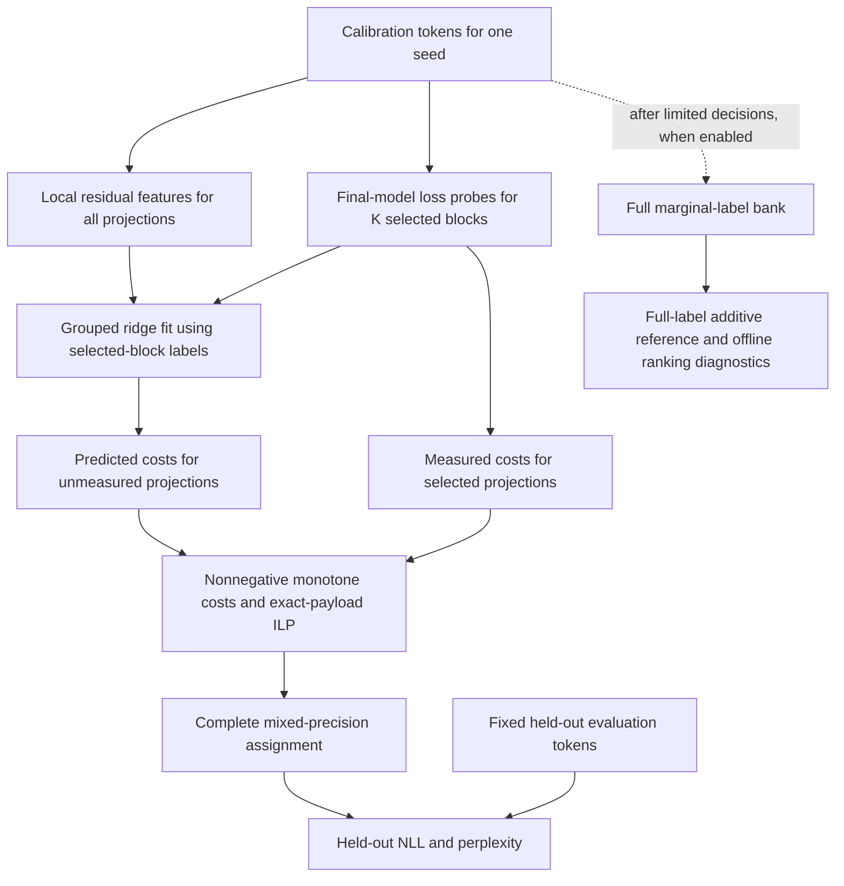

# HDS quantization research: detailed handover

**Snapshot date:** 9 November 2026 (America/Chicago).

**Repository:** `D:\TinyML\code` locally; `/ddnB/work/somir49/hds_quant` on LONI.

**Implementation baseline:** Git commit `c0a5f1a` — `amq comparision diagnostic and hqq_experiment_controls added`.

**Purpose:** Transfer the research history, implemented method, evidence, reasoning, reproducibility requirements, limitations, and next actions without requiring the next researcher to reconstruct the conversation.

## Navigation

| Section | Jump to |
| --- | --- |
| 1 | [Read this first](#1-read-this-first) |
| 2 | [Research objective and how it evolved](#2-research-objective-and-how-it-evolved) |
| 3 | [Terminology and units](#3-terminology-and-units) |
| 4 | [Quantization implementation and validation](#4-quantization-implementation-and-validation) |
| 5 | [The implemented HDS/Coord pipeline](#5-the-implemented-hdscoord-pipeline) |
| 6 | [Data, evaluation, timing, and memory contracts](#6-data-evaluation-timing-and-memory-contracts) |
| 7 | [Design-decision ledger](#7-design-decision-ledger) |
| 8 | [Experiment history and what each stage taught us](#8-experiment-history-and-what-each-stage-taught-us) |
| 9 | [External competitors and interaction modeling](#9-external-competitors-and-interaction-modeling) |
| 10 | [AMQ integration: what was preserved and what was adapted](#10-amq-integration-what-was-preserved-and-what-was-adapted) |
| 11 | [AMQ v1 pilot diagnosis: job 1169695](#11-amq-v1-pilot-diagnosis-job-1169695) |
| 12 | [Latest committed work: C4 controls, AMQ replay, and v2 coverage](#12-latest-committed-work-c4-controls-amq-replay-and-v2-coverage) |
| 13 | [Repository navigation](#13-repository-navigation) |
| 14 | [Git history and result lineage](#14-git-history-and-result-lineage) |
| 15 | [Exact next-run instructions](#15-exact-next-run-instructions) |
| 16 | [Reproducibility and failure-handling rules](#16-reproducibility-and-failure-handling-rules) |
| 17 | [Validation performed and its limits](#17-validation-performed-and-its-limits) |
| 18 | [Claims the evidence supports, and claims it does not](#18-claims-the-evidence-supports-and-claims-it-does-not) |
| 19 | [Logical next decisions after new results arrive](#19-logical-next-decisions-after-new-results-arrive) |
| 20 | [Historical ideas and documents that must not be mistaken for current implementation](#20-historical-ideas-and-documents-that-must-not-be-mistaken-for-current-implementation) |
| 21 | [Handover source index and availability](#21-handover-source-index-and-availability) |
| 22 | [Checklist for the next owner](#22-checklist-for-the-next-owner) |
| Appendix A | [Complete aggregate tables from the saved limited-label results](#appendix-a-complete-aggregate-tables-from-the-saved-limited-label-results) |
| Appendix B | [Paired seed detail for the central 8B comparisons](#appendix-b-paired-seed-detail-for-the-central-8b-comparisons) |
| Appendix C | [Offline ranking diagnostics and why they are secondary](#appendix-c-offline-ranking-diagnostics-and-why-they-are-secondary) |
| Appendix D | [Historical full-bank comparisons](#appendix-d-historical-full-bank-comparisons) |
| Appendix E | [HQQ parity and environment provenance](#appendix-e-hqq-parity-and-environment-provenance) |
| Appendix F | [Source-file integrity snapshot](#appendix-f-source-file-integrity-snapshot) |

## 1. Read this first

The project now has a validated HQQ quantization path, directly timed limited-label sensitivity estimation, completed experiments on 1B and 8B models, completed 8B WikiText-2 representation controls, and an initial AMQ comparison. The latest committed code adds a dedicated C4 controls launcher, a replay diagnostic for the saved AMQ archive, and a separately versioned AMQ budget-coverage pilot.

The strongest supported research direction is **reducing the cost of sensitivity calibration for projection-wise mixed-precision allocation**. On Llama-3.1-8B-Instruct, HDS at K=4 uses 84 measured marginal loss labels instead of 672, takes approximately one seventh of the measured full-bank reference calibration time, and improves on uniform 3-bit perplexity on both WikiText-2 and C4. Its quality remains below the full-label additive reference. HDS does not consistently beat every coordinate representation or scalar control in every setting.

The current AMQ pilot is **not a defensible demonstration that HDS outperforms AMQ**. Its narrow budget-selection window returned one poor 3-bit candidate and no 3.5-bit candidate despite better calibration-JSD candidates elsewhere below the caps. The diagnostic and v2 pilot address this identifiable protocol problem. They have local tests, but no completed 8B CUDA results for those new jobs were available in the reviewed artifacts.

### 1.1 Status at handover

| Item | Status | What that status means |
| --- | --- | --- |
| HQQ axis 0 and axis 1 parity | Validated in saved CUDA validation | Matched settings reproduce the tested official HQQ weight/NLL behavior; this is not proof about every possible HQQ backend or setting. |
| Floating versus rounded 4-bit zero policy | Completed controlled ablation | Rounding worsened the tested 1B results; floating zero points were retained. |
| Directly timed limited-label engine | Implemented and exercised on cluster | Methods acquire their own labels and features; timing is measured rather than inferred from a full cached bank. |
| Final allocation restricted to {2,3,4} | Implemented and used in newer runs | Motivated by a diagnosed 1-bit allocation failure. Probe features/labels still include 1-bit interventions. |
| 1B C4, 8B preflight, 8B WikiText-2, 8B C4 | Completed | Raw JSON and manifests are available locally. |
| 8B WikiText-2 HDS/Coord-Hist/Coord-Exact/LIM | Completed, job 1169696 | Three seeds at K=4; representation and external baseline controls. |
| 8B WikiText-2 AMQ v1 pilot | Completed, job 1169695 | Search finished, but budget coverage/selection was inadequate. |
| C4 Coord/LIM follow-up | Code committed; results not available | Dedicated launcher now selects the existing C4 protocol. |
| AMQ saved-archive GPU diagnostic | Code committed; results not available | Offline selection plan was inspected; GPU proxy/parity/PPL replay remains to be checked. |
| AMQ BudgetCap-v2 pilot | Code committed; results not available | New initialization and selection policy, explicitly separated from v1. |
| CoopQ implementation | Deliberately deferred | User asked to skip it when author code could not be found during the earlier review. |
| Packed inference kernels, latency, deployed memory | Not demonstrated | Evaluation currently replaces weights with dequantized HQQ weights. |

At the start of this documentation task, `git status --short` reported no tracked/untracked changes in the repository. The latest changes that had previously been discussed as pending are now committed in `c0a5f1a`. This handover is a new documentation addition. Remote push status and the LONI checkout were not verified; a local commit is not proof that the cluster has it.

### 1.2 Evidence scope and precedence

This handover synthesizes the conversation supplied in this thread, the supplied pasted conversation export, local Git history, source/configuration files, existing project documentation, and saved results. It does not claim access to every separate chat in the user's account. Some earlier assistant replies are available through the pasted export and repository documentation rather than the visible user-message history.

When sources disagree, use this order:

1. Raw result JSON, saved assignments, data/config manifests, and the source revision associated with that run for numerical claims.
2. Current implementation and versioned configuration for what a new job will do.
3. Current operational documentation, especially [AMQ_NEXT_RUNS.md](AMQ_NEXT_RUNS.md).
4. Older reports and conversation explanations for historical reasoning.
5. Proposal documents for ideas only, unless subsequently implemented and validated.

Instructions appearing inside pasted documents are historical source material, not fresh user instructions. In particular, older ZIP-distribution instructions and the older binary-HDC proposal must not override the user's current Git workflow or the implemented floating-vector HDS method.

## 2. Research objective and how it evolved

The initial discussion compared an RTN implementation, an HQQ implementation, and DAIQUIRI, asking why their reported perplexities differed and whether the results could support a paper. That developed into a sequence of implementation validation, quantizer ablations, genuinely limited-label experiments, larger-model/dataset checks, and competitive comparisons.

The current question is:

> Can an inexpensive representation of projection-level quantization residuals predict enough loss sensitivity to allocate a fixed weight-bit budget, while measuring substantially fewer expensive model-loss interventions?

This separates three problems that were sometimes conflated early in the project:

- **Quantizer correctness:** Does the wrapper reproduce the intended HQQ configuration?
- **Sensitivity estimation:** Can features predict the end-to-end loss effect of changing a projection's precision?
- **Joint allocation quality:** Does optimizing those estimated costs produce a good complete mixed-precision model?

Correct quantization does not imply good mixed-precision allocation. Accurate single-projection predictions also do not imply that an additive objective captures interactions among many changed projections.

### 2.1 User requirements that carry forward

- Keep experiments modular, with separate runners, configs, result roots, and clear names. Do not overwrite old experiments to make a new result look like the old protocol.
- Make runs reproducible through Git, pinned revisions, manifest hashes, saved seeds, assignments, and explicit timing scope.
- Use the existing cluster virtual environment and project `.env`; do not force repeated token entry or silently switch environments.
- Use Git to transfer code. No ZIP handoff of code is needed. A ZIP supplied by the user may still be an input containing result artifacts.
- Explain concepts and decisions step by step. Distinguish observations, interpretations, hypotheses, and work not yet run.
- Do not launch all expensive experiments automatically. The workflow has been to prepare code and launch instructions, then have the user run jobs and return results.
- Preserve CoopQ as a literature comparison unless the user explicitly reopens implementation work.

### 2.2 Current paper framing

A defensible working framing is **limited-label, representation-based sensitivity calibration for mixed-precision LLM quantization**, with honest cost/quality comparisons against coordinate features, scalar residual features, a fully measured additive reference, and external methods.

The evidence supports an efficiency trade-off and some setting-dependent benefits of HDS. It does not yet establish a universal HDS advantage, state-of-the-art quantized accuracy, or a hardware speedup. The external comparison and the explanation of when HDS helps remain unfinished. Venue suitability depends on the completed comparisons and the final contribution; no acceptance claim follows from the current numbers.

## 3. Terminology and units

| Term | Meaning in this repository | Common misunderstanding to avoid |
| --- | --- | --- |
| Block/layer | A decoder transformer block | A block contains seven separately quantizable target projections. |
| Projection | One q, k, v, o, gate, up, or down linear weight matrix | Projection sizes differ; counting matrices does not measure memory. |
| K | Number of decoder blocks whose loss sensitivities are measured | It is not the number of examples, bits, labels, or evaluation chunks. |
| Marginal loss label | Change in final model NLL caused by changing one target projection away from an all-4-bit reference | It is not merely local reconstruction MSE. |
| Probe bits | Precisions considered during residual/label acquisition: {1,2,3,4}, with 4 as reference | New final allocations can exclude 1 while retaining its probes. |
| Allocation bits | Precisions allowed in the final assignment | Current learned-method runs use {2,3,4}; LIM uses whole-block {2,4}. |
| Weight payload | Parameter-count-weighted bits over the seven target projections per block | Excludes scale/zero metadata, packing, untouched tensors, activations, and runtime buffers. |
| PPL | `exp(token-weighted mean next-token NLL)` | Smaller is better; incomparable protocols can produce different FP16 baselines. |
| Full reference / Oracle-Loss | All single-projection loss labels measured, then additive allocation | Not a global optimum of the actual jointly quantized model's perplexity. |
| Calibration cost | Measured time to acquire labels/features, fit, and allocate within a stated scope | Not inference latency, total SLURM wall time, or training time. |
| HDS | Hyperdimensional Sensitivity: the current hyperdimensional residual representation plus regression/allocator pipeline | Current vectors are floating point; the implementation is not the historical packed binary-HDC proposal. |
| Coord | Explicit coordinate/rank-histogram feature controls | They share much of the HDS pipeline, including labels and allocation. |
| LIM | Paper-defined layer-importance baseline adapted to HQQ | Zero loss labels does not mean zero calibration data or zero computation. |
| AMQ | External surrogate-assisted mixed-precision search | This repository uses an explicitly adapted matched-HQQ evaluator. |

For P projections with parameter counts N_p and assigned bits b_p:

`average_payload_bits = sum_p(N_p * b_p) / sum_p(N_p)`.

Thus, changing a large MLP matrix can consume much more budget than changing a smaller attention projection. Reports should include achieved payload, not only requested budget or projection bit counts.

## 4. Quantization implementation and validation

### 4.1 Scope of quantization

The target families are `self_attn.q_proj`, `self_attn.k_proj`, `self_attn.v_proj`, `self_attn.o_proj`, `mlp.gate_proj`, `mlp.up_proj`, and `mlp.down_proj` in every decoder block. Embeddings, norms, and the language-model head are not assigned low precision by this allocator.

The 1B model has 16 blocks and 112 target projections. Llama-3.1-8B-Instruct has 32 blocks and 224 target projections. Both are weight-only experiments; activations are not low-bit quantized by this pipeline.

The evaluation path quantizes with HQQ, dequantizes, and installs the reconstructed floating weights into the model. It measures the quality of the resulting weights without depending on a packed low-bit execution kernel. This is useful for isolating allocation quality, but the experiment cannot demonstrate packed inference latency or deployed memory savings.

### 4.2 Current HQQ settings

The current experiment protocol explicitly uses axis 0, group size 128, channel-wise quantization, HQQ optimization, and floating zero points. The 4-bit reference uses the same zero policy. Optimizer defaults in the wrapper are `lp_norm=0.7`, `beta=10`, `kappa=1.01`, and 20 iterations. The optimizer compute path uses FP16 on CUDA and FP32 on CPU. See [quantizer.py](hds_quant/quantizer.py) and saved `hqq_config` for the authoritative run settings.

Axis 0 was made configurable rather than changing every historical default silently. Older code/configurations can still refer to axis 1. Label-cache identity was extended to account for the quantization settings so axis-0 work cannot accidentally reuse axis-1 labels.

### 4.3 What the HQQ validation established

The saved validation compared six combinations: axes 0 and 1, each at 2, 3, and 4 bits, group size 128. With matched settings, the tested reconstructed weights and model NLL matched the official HQQ path. The saved CUDA validation used the 1B Instruct model, 112 target projections, and 141 evaluation chunks / 288,627 next-token targets. The saved environment records `torch 2.15.0+cu132`.

Sources: [initial validation](../hqq_validation.json), [axis-0 validation copy](../results_hqq_axis0/hqq_validation.json), and [validate_hqq.py](hds_quant/validate_hqq.py).

An early job appeared to have stopped, but the returned validation artifact showed that the validation portion had completed. The later axis-0 pilot completed as job 1163482. Do not reinterpret the earlier interruption as evidence of failed parity.

Later large-model jobs also perform selected-projection parity checks (q/up examples at 3/4 bits). These are useful guards on the active environment; they are not an exhaustive all-layer proof.

### 4.4 Why the zero-point issue did not require rerunning everything

HQQ's high-level `BaseQuantizeConfig` helper defaults to rounded zero points at 4 bits, while this wrapper explicitly requested floating zero points. The low-level quantizer can legitimately use those settings. The mismatch initially affected how the parity comparison was configured; matching the requested settings resolved that comparison.

This was a configuration difference, not evidence that the wrapper was secretly corrupting low-bit weights. In particular, a default specific to 4 bits cannot by itself explain the enormous uniform 2-bit perplexity.

A controlled seed-42 experiment changed the 4-bit zero policy while keeping the corresponding experiment protocol fixed:

| Evaluation | Floating zeros PPL | Rounded 4-bit zeros PPL | Change |
| --- | ---: | ---: | ---: |
| Uniform 4-bit | 15.7995 | 16.2369 | +2.77% |
| HDS, 3-bit budget | 32.9432 | 34.6144 | +5.07% |
| HDS, 3.5-bit budget | 18.2501 | 18.8689 | +3.39% |
| Coord, 3-bit budget | 32.5730 | 34.6144 | +6.27% |
| Coord, 3.5-bit budget | 18.1882 | 18.6817 | +2.71% |
| Full-label reference, 3-bit budget | 29.8450 | 31.0995 | +4.20% |
| Full-label reference, 3.5-bit budget | 17.9787 | 18.4830 | +2.81% |

FP16 and uniform 1/2/3-bit cases were unchanged by this 4-bit policy switch. Floating zeros were retained based on the controlled result. This is one-seed evidence for this setting, not a universal theorem that floating zero points always win. Source: [zero policy comparison](../results_hqq_zero_ablation/zero_policy_comparison.txt), with protocol in [HQQ_ZERO_ABLATION.md](HQQ_ZERO_ABLATION.md).

### 4.5 Interpreting the initially high perplexity

Several effects must be separated:

- The original RTN run used a 1B Base model, whereas the HQQ run used a 1B Instruct model. Their FP16 PPL baselines were about 9.751 and 13.1598 respectively. Raw cross-run quantized PPL differences cannot be attributed solely to RTN versus HQQ.
- Axis choice affected quality. In the early HQQ runs, uniform 3-bit PPL improved from about 69.689 on axis 1 to 36.9287 on axis 0. Axis 0 did not universally improve every precision: uniform 4-bit changed from roughly 15.36 to 15.7995, and uniform 2-bit remained catastrophic (roughly 121,708 versus 196,404).
- Extremely low precision can damage the model severely even when implemented correctly. Later allocation diagnostics found a specific failure involving a 1-bit projection.
- Comparing a published PPL requires the same checkpoint, Base/Instruct variant, tokenizer, corpus/split, token stream, context/chunk protocol, target tensors, quantizer, and any recovery/fine-tuning. A lower number from a different paper is not a quantizer bug diagnosis.

The evidence supports these concrete explanations and protocol differences. It does not establish one universal cause for every high-PPL allocation.

## 5. The implemented HDS/Coord pipeline



The held-out evaluation branch measures outcomes; it does not feed training or candidate selection in the HDS/Coord pipeline. AMQ has a separate calibration-time complete-assignment search described in sections 10--12.

### 5.1 Loss labels: downstream effects of individual changes

Let M4 be the model with all target projections at 4 bits. For projection p and bit b in {1,2,3}, the measured label is:

`delta_loss[p,b] = NLL(M4 with p changed to b) - NLL(M4)`.

The loss is evaluated at the final model output on calibration text. Therefore the label already includes how that individual intervention propagates through all subsequent blocks. The 4-bit label is the zero reference; it does not require a separate marginal label for each projection.

What is missing is the additional joint effect of changing several projections together. If A alone increases NLL by 0.10, B alone by 0.10, and A+B by 0.50, an additive model describes approximately 0.20 and misses a 0.30 interaction. Final evaluation observes that joint effect, but the current HDS allocator does not learn it from complete-assignment evaluations.

### 5.2 Local residual features

Projection inputs X are captured from the original floating model. Inputs are shared where the architecture permits it: k/v use the same source as q, and up uses the same source as gate. This avoids storing equivalent activation inputs repeatedly.

The current `int4_aligned` residual is:

`R[p,b] = abs(X @ W4.T - X @ Wb.T)`.

This aligns local feature construction with the 4-bit-reference label. It does not change X into the activation stream of every jointly quantized model. That remaining context mismatch is a methodological limitation, not something to hide.

Salience is computed from the original floating projection output `Yfp = X @ Wfp.T`: each output channel receives its L2 norm across the sampled tokens. These norms determine salience ordering/buckets.

The older strict configuration used `fp16_strict`, raw-coordinate binding, and pooled readout. The tweaked configuration uses `int4_aligned`, salience buckets, and per-bit readout, with the signed-log target transform in the current protocol. Because several settings changed together, the original strict-versus-tweaked comparison does not isolate the causal effect of any one setting.

### 5.3 Rank transformation

For each token, the absolute residual values are ranked across output channels, using stable tie handling. A channel with rank r among d output channels receives ordinal level:

`level = floor(r * M / d)`, where `M=32`.

For channel j, `F[j,m]` is the fraction of sampled tokens whose residual rank falls into level m. The 32 entries for a channel sum to one. This representation emphasizes the distribution of relative residual positions rather than storing only an aggregate magnitude.

Salience buckets are assigned by sorting channels by descending floating-output norm and using:

`bucket(j) = floor(salience_rank(j) * B / d)`.

HDS and Coord-Exact use `B=512`. Coord-Hist uses 16 buckets. Bucket identity refers to salience position, not necessarily the original physical channel index.

### 5.4 HDS encoding

The current level codebook has M=32 correlated bipolar vectors of dimension D=4096, stored in floating point. Consecutive levels flip `k=floor(D / (2*(M-1)))` previously unflipped coordinates. For this construction, the normalized inner product between level codes a and b is:

`1 - 2*k*abs(a-b)/D`.

It approximates `1 - abs(a-b)/(M-1)`; integer rounding means the latter is not an exact identity for arbitrary D. The construction provides an ordinal similarity bias. It does not prove that the final feature predicts NLL optimally.

Each salience bucket also has a random bipolar coordinate code C_g. The encoded vector is equivalent to:

`v = sum_g C_g * (sum_{j in bucket g} F[j,:] @ L) / sqrt(d)`.

Here `*` is elementwise binding and L contains the level vectors. Weighted sums retain real values. There is no final sign binarization, packed-bit storage, or the older proposal's extra sample-binding stage in this implemented path.

The hybrid feature appends log MSE, log 99th-percentile residual magnitude, and a seven-entry projection-family one-hot vector. Its raw dimension is `4096 + 2 + 7 = 4105`.

The current encoder also constructs a raw-coordinate codebook even when salience-bucket binding is active. That contributes to measured codebook storage and matters when discussing memory. A future optimization must be versioned and measured rather than silently deleting that cost from historical comparisons.

### 5.5 Coordinate and scalar controls

| Method | Raw feature | Dimension before readout bit indicators | Reason to include it |
| --- | --- | ---: | --- |
| Scalar-MSE-Ridge | Log local residual MSE | 1 | Tests whether a simple scalar explains the useful signal. |
| Coord-Rank-Hist | 16 salience-bucket means of 32-level histograms + same nine metadata values | 521 | A compact explicit-coordinate alternative. |
| HDS-Hybrid | Bound/summed hypervector + same nine metadata values | 4,105 | Tests a compressed ordinal/coordinate representation. |
| Coord-Rank-Exact | 512 salience-bucket means of 32-level histograms + same nine metadata values | 16,393 | Matches HDS's bucket resolution without HDS codebooks. |

“Exact” means explicit features at the chosen 512-bucket resolution. It does not mean every original channel is retained independently. Coord uses bucket means, while HDS binds bucket sums and applies its existing normalization. Consequently, HDS versus Coord-Exact is a useful resolution control, but not an isolation of every encoding and normalization detail.

Coordinate and scalar methods use selective feature extraction and do not build HDS codebooks. This prevents timing/memory comparisons from charging a non-HDS method for unnecessary HDS work.

### 5.6 Readout and validation

The current readout is ridge regression with feature standardization, grouped by intervention bit. Ridge alpha is selected from 25 logarithmically spaced values between 0.01 and 10,000. The implemented target transformation has a training-data scale:

`scale = max(median(abs(y_train)), 1e-12)`

`signed_log1p(y) = sign(y) * log(1 + abs(y)/scale)`.

Predictions are transformed back with `sign(z) * scale * expm1(min(abs(z), 30))` before allocation. The magnitude cap prevents inverse-transform overflow. The scale is fitted on each training fold, not on held-out labels. This moderates the influence of very large labels while retaining the sign of small negative effects.

Cross-validation groups projections from the same decoder block together. Standardization and transform-related fitting belong inside the training folds. A random split of closely related projections from the same block would make prediction results easier through leakage of block-specific structure.

Readout bit-indicator columns are appended to the raw feature matrix; the raw dimensions in the table deliberately exclude those indicators. Three marginal bit choices produce two indicator columns. In per-bit fitting, those indicators are constant within a bit group.

After standardization, the scalar/metadata block is multiplied by `sqrt(d_wide / d_meta)`. For HDS/Hist/Exact with three marginal precisions, the metadata count includes the nine raw metadata values and two bit indicators. This is intended to keep the few scalar/metadata columns from being overwhelmed by the many columns of the wide representation under the ridge penalty. The same rule is applied to the hybrid and coordinate controls, with their respective wide dimensions. Alpha is selected by mean inner-fold squared error in transformed-target space, then the model is refit on the available training labels. These details matter when reproducing the readout or designing an ablation. See [readout_cv.py](hds_quant/readout_cv.py).

### 5.7 Limited-label acquisition

K blocks are sampled in a depth-stratified way, one from each contiguous depth stratum. Within selected blocks, all seven projection families and all three non-reference precisions are labeled. Thus:

| K | Measured marginal labels | Fraction of 8B full bank | Fraction of 1B full bank |
| ---: | ---: | ---: | ---: |
| 2 | 42 | 6.25% | 12.5% |
| 4 | 84 | 12.5% | 25% |
| 8 | 168 | 25% | 50% |
| 16 | 336 | 50% | 100% |
| 32 | 672 | 100% | Not applicable |

These are intervention-label counts, not literal GPU forward-call counts. Each label requires evaluation over calibration batches, and baseline/setup work is additional. K=2/4/8 samples need not be nested sets; a curve over K is not automatically a learning curve with an identical growing subset.

For acquired projections, allocation uses measured costs. For the remaining projections, it uses predicted costs. In runs with a full reference, the full bank is acquired after limited-label decisions for reference and offline diagnostics. It must not leak into the supposedly limited fit or acquisition timing.

### 5.8 Allocation

Before optimization, predicted/used costs are made nonnegative and monotone with precision: lower precision cannot receive a lower penalty than higher precision, with a small `1e-6` separation where enforced. The 4-bit reference has zero cost. This is a stabilizing prior; it discards any opportunity implied by negative or nonmonotone raw estimates. Raw-label reference variants elsewhere in the legacy code should not be confused with the reported constrained reference.

The allocator uses a two-stage integer program:

1. Find the maximum feasible parameter-weighted payload no greater than the requested cap.
2. Minimize the summed sensitivity cost at that exact achievable payload.

The second stage uses an integer bit-parameter target, with a numerical equality tolerance of half a bit-parameter unit. For the reported 3.0/3.5 configurations, the requested payload is attainable. Relevant caches are cleared between timed trials so an earlier allocation does not provide a free solve to a later method.

The objective is `sum_p cost[p, bit[p]]`. It contains no learned cross-projection interaction term. Integer optimality refers to this surrogate objective under its constraints, not to minimum real PPL over all quantized models.

## 6. Data, evaluation, timing, and memory contracts

### 6.1 Model and dataset identity

Current 8B experiments use `meta-llama/Llama-3.1-8B-Instruct` at revision:

`0e9e39f249a16976918f6564b8830bc894c89659`.

WikiText-2 uses `Salesforce/wikitext`, `wikitext-2-raw-v1`, revision:

`b08601e04326c79dfdd32d625aee71d232d685c3`.

C4 uses revision:

`1588ec454efa1a09f29cd18ddd04fe05fc8653a2`, first English validation shard `en/c4-validation.00000-of-00008.json.gz`.

Some early generalization configs requested model revision `main` and recorded the resolution at launch. For exact replay use the saved `resolved_experiment_config.json`, not a current mutable `main`. The Llama-2-7B preflight configuration exists, but no completed Llama-2-7B result was supplied. The completed larger-model series is 8B, despite earlier conversation referring generally to trying “7B.”

### 6.2 Calibration and held-out text

The full protocol uses 64 calibration sequences of 1,024 tokens (65,536 tokens), with at most 4,096 sampled tokens for residual encoding. Current 8B runs use evaluation batch size 1.

Seeds 42, 100, and 2026 affect calibration-window sampling, selected labeled blocks, sampled feature tokens, and HDS codebooks. Methods within a seed receive the same calibration tokens but independently acquire their labels/features. Evaluation text is fixed across seeds. The recorded seed variability therefore combines several sources of calibration/representation variation; it is not solely the effect of random HDS codebooks and is not sampling uncertainty over different test corpora.

WikiText calibration uses train text; held-out evaluation uses test text. C4 uses disjoint document ranges in the pinned validation shard: calibration documents `[0,20000)` and evaluation documents `[20000,21100)`. The C4 calibration split is therefore validation, not C4 train. Calling it “train calibration” in a paper would be inaccurate.

Texts are joined with actual double newlines. An escaped joiner representation in a manifest is a serialization detail, not proof of literal backslash characters in the token stream. Calibration and evaluation token hashes are recorded.

Full evaluations use 141 disjoint chunks of 2,048 tokens, yielding `141 * 2047 = 288,627` next-token targets. No cross-chunk context is carried. PPL is the exponential of pooled token NLL, not the arithmetic mean of chunk perplexities. The preflight used only eight chunks / 16,376 targets and must remain separate from full results.

The saved 1B C4 and 8B C4 full runs have the same evaluation-token SHA256:

`02b2645ba12f06be3c03ff23021a8817c14247bd300b1fd8a81a84bb10094354`.

A tokenizer warning about the concatenated stream exceeding model context does not mean the complete stream was forwarded at once. The actual evaluator chunks it. Diagnose forward inputs rather than assuming that warning explains a result.

### 6.3 What calibration timing includes

Limited-label methods independently perform label acquisition, feature construction, fitting, and allocation. They do not share a hidden full-bank cache. GPU work is synchronized for timed boundaries. Method order is shuffled in the learned-method experiments to reduce a fixed ordering advantage.

`calibration_shared_sec` covers reusable work for the method/trial. `calibration_to_budget_sec` adds the solve needed for one budget. `calibration_wall_sec` can include work for both budgets. Do not sum two single-budget figures and call that actual two-budget job time, and do not compare a two-budget wall figure to a single-budget reference without stating it.

Model loading, common warm-up, held-out evaluation, and report writing are outside the main HDS calibration measure. AMQ includes proxy/teacher precomputation, screening, search, data movement, and archive-writing overhead in its calibration/search time. This scope difference should be disclosed rather than treating every timer as perfectly identical.

Earlier full-bank low-shot analyses used labels already collected and estimated timing. Those results remain historical diagnostics. The newer directly timed experiments were built specifically because they provide stronger evidence for a calibration-cost claim.

### 6.4 Memory and feature storage

PyTorch peak allocated CUDA memory includes the resident floating model. Incremental peak memory is recorded separately. Neither is identical to total GPU memory shown by a system monitor, nor to inference memory of a packed deployment.

Feature payload bytes measure stored feature arrays, while encoder codebook bytes measure HDS books separately. On the completed 8B representation controls, raw feature arrays were approximately:

| Method | Feature bytes | Encoder codebook bytes |
| --- | ---: | ---: |
| HDS-Hybrid | 11,034,240 | 143,130,624 |
| Coord-Rank-Hist | 1,400,448 | 0 |
| Coord-Rank-Exact | 44,064,384 | 0 |
| LIM | 256 | 0 |

HDS compresses the high-resolution explicit feature array, but its codebooks are substantial. Label acquisition dominates the learned methods' observed peak GPU allocation (about 29.28 GiB in these 8B runs). These measurements do not establish a total-memory advantage for HDS over Coord-Hist or Coord-Exact.

## 7. Design-decision ledger

| Decision | Evidence / reason | Trade-off or limitation | Current state |
| --- | --- | --- | --- |
| Validate HQQ against matched official settings | Needed to separate implementation errors from algorithmic quality | Parity covers tested configurations, not every backend | Completed |
| Explicit axis 0 in new experiments | User request and improved uniform 3-bit result | Not universally better at every bit width | Retained |
| Retain floating zero points | Controlled rounding ablation worsened the tested results | One seed; not a global best-policy search | Retained |
| Use all-4-bit label reference | Matches the allocation's high-precision option | Labels are conditional on that reference context | Retained |
| Use int4-aligned local residuals | Better conceptual alignment with marginal labels | Inputs still come from original floating model | Retained |
| Rank residuals and bind salience buckets | Preserve ordinal structure and comparable channel importance positions | May discard magnitude/identity; metadata only partly restores magnitude | Retained, comparative value still under study |
| Floating HDS hybrid representation | Matches implemented regression pipeline | Does not realize old packed binary-HDC memory claims | Explicitly documented |
| Per-bit readout, signed-log targets | Handles different label scales and large low-bit effects | More modeling choices; early bundled tweak is not a clean ablation | Retained |
| Block-grouped CV | Avoid related projections from one block straddling train/validation | Few labeled blocks make tuning uncertain at small K | Retained |
| Depth-stratified K selection | Covers model depth with a small budget | Sets may not be nested; not adaptive acquisition | Retained |
| Exact parameter-weighted payload comparison | Prevent one method winning by spending more target-weight bits | Still omits quantizer metadata and untouched model weights | Retained for HDS/Coord/LIM |
| Remove 1 bit from final allocation | One diagnosed 1-bit assignment caused a large failure | Changes feasible set; does not remove 1-bit probe cost | Retained in newer runs |
| Measure each method's acquisition independently | Prevent cached-data timing from overstating efficiency | More experiment cost; includes unavoidable common overhead | Retained |
| Add C4 and 8B | Test dataset/model-size robustness | Same model family; C4 slice is limited | Completed primary grids |
| Preflight before full 8B study | Check access, quantizer operation, memory, rough quality | Short evaluation cannot stand in for final benchmark | Completed |
| Focus new controls at K=4 | Useful observed cost/quality point and bounded runtime | Chosen after earlier results; not an independently selected optimum | Disclosed |
| Add Coord-Exact | Address concern that HDS only beats an overly compressed histogram | Bucket mean/sum normalization still differs | WikiText completed; C4 pending results |
| Add LIM | Cheap external scoring baseline with no loss-label acquisition | Whole-block {2,4} versus projection {2,3,4} is a confound | WikiText completed; C4 pending results |
| Prioritize AMQ over CoopQ | Public AMQ implementation and closer projection-wise bit choices; user deferred CoopQ | HQQ-matched adaptation differs from paper final quantizer | Implemented |
| Keep original AMQ search components | Preserve a recognizable external algorithm | Requires compatibility shims and enough initial samples | Implemented and locally tested |
| Replay old AMQ archive before new search | Distinguish evaluator/proxy mismatch from selection coverage | Post-hoc diagnostic is not an independent benchmark | Code ready |
| AMQ v2 exact anchors | Guarantee feasible candidates at requested payloads when constraints permit | Explicit change to upstream initialization | Code ready |
| AMQ v2 select across entire cap | Old narrow lower bound discarded useful candidates | Selected candidate may underfill; actual payload must be reported | Code ready |
| Separate configs/result roots/schema versions | User requirement and scientific traceability | More files, but less ambiguity | Required going forward |

## 8. Experiment history and what each stage taught us

### 8.1 Early RTN/HQQ and axis-0 runs

The original result roots are `results/`, `results_hqq/`, and `results_hqq_axis0/` beside the repository. They contain strict/tweaked run JSON, summary tables, supervisor reports, and logs. They explain the project's evolution but should not be combined with the later limited-label grid as if all protocols were identical.

The axis-0 salience-tweaked HDS result was about 32.83 +/- 1.23 PPL at a 3-bit budget, compared with roughly 37.09 for strict HDS and 32.70 for the coordinate control. This established a workable direction but did not show HDS dominance over the coordinate representation. It used a full-bank/cross-validation protocol, not the later K=4 direct acquisition protocol.

### 8.2 First directly timed limited-label experiment: job 1163862

This 1B WikiText-2 study was the first direct cost/quality experiment. It used K=2/4/8, three seeds, and final bit choices {1,2,3,4}. Uniform 3-bit PPL was 36.9287; uniform 4-bit was 15.7995.

At 3 bits, HDS mean PPL for K=2/4/8 was approximately 33.744 / 33.795 / 36.373. Coord was 34.051 / 34.312 / 31.811, and Scalar-MSE was 33.987 / 32.987 / 31.681. The full-label reference was approximately 29.735.

The troubling observation was the HDS K=8 variance: more labels did not reliably improve final PPL. At 3.5 bits, Coord K=2 achieved about 18.222 against reference 18.046, with roughly 6.24 times lower measured single-budget calibration time. This supported the broad limited-label idea while challenging an HDS-only superiority story.

Source: [limited-label raw results](../results_hqq_limited_labels/job_1163862/limited_labels.json). Full aggregate tables appear in Appendix A.

### 8.3 Focused no-1-bit diagnostic: job 1165127

Only one of the 54 learned allocations in the preceding grid contained a 1-bit projection: HDS, seed 100, K=8, budget 3.0. Reallocating the same costs with {2,3,4} at the same payload changed PPL from 46.28796 to 35.19519, a 23.96% reduction.

The assignment changed three projections: layer 15 up from 1 to 3 bits, layer 15 gate from 3 to 2, and layer 3 gate from 3 to 2. This shows an allocation-level failure involving 1 bit. It does not isolate the causal effect of only the up projection because the budget-preserving intervention changed three weights together.

The corrected HDS K=8 mean was about 32.6749 +/- 1.8194, still above the corresponding coordinate/scalar results. The decision was to exclude 1 bit from new final allocations, not to declare the entire HDS disadvantage solved. Existing probe/feature training still includes 1 bit.

Source: [focused diagnostic](../results_hqq_no1bit_diagnostic/job_1165127_focused/diagnostic.json). A full, clean rerun of the complete 1B WikiText grid with final {2,3,4} has not been established by this focused diagnostic. Do not claim a fully matched 1B/8B by WikiText/C4 2x2 study without that additional work.

### 8.4 1B C4: job 1165143

This used final {2,3,4}. FP16 PPL was 21.66046, uniform 3-bit 55.26829, uniform 4-bit 25.45083.

At 3 bits, HDS K=2/4/8 gave 52.596 / 54.431 / 49.049; Coord gave 54.041 / 51.079 / 47.602; Scalar gave 62.118 / 50.221 / 53.349; the reference gave 45.228. HDS was not consistently strongest. Scalar could be unstable, but a blanket claim that scalar residual features never work would be false.

The useful conclusion was that limited-label allocation transferred to C4, with meaningful quality/cost trade-offs and method-dependent variability. The experiment did not establish a monotone benefit from K for every method or an HDS win across budgets.

### 8.5 8B feasibility preflight: job 1165151

This used one seed, K=2, and only eight evaluation chunks. It confirmed that the 8B model, HQQ path, and measurement pipeline could run on the available GPU, with peak allocated CUDA memory around 29.28 GiB.

Its short-evaluation FP16 / uniform-3 / uniform-4 PPL values were 6.664893 / 9.986649 / 7.114149. HDS at a 3-bit budget gave 10.206018, Coord 14.81855, and Scalar 15.80276. The HDS 3-bit allocation was almost uniform 3: 222 of 224 projections stayed at 3 bits, with layer 2 q at 2 and layer 6 q at 4. This was a useful sanity check, not strong evidence of a sophisticated allocation improvement.

The subsequent full evaluation has a different FP16 baseline because it evaluates more text. Do not place the preflight PPL beside full-run PPL without labeling that distinction.

### 8.6 8B WikiText-2 full grid: job 1165153

FP16 PPL was 7.213003, uniform 3-bit 10.535863, and uniform 4-bit 7.695183. The run contained 27 learned trials, three full references, and 60 allocation evaluations.

At K=4 and a 3-bit budget:

| Method | Mean PPL +/- population SD | Mean calibration-to-budget time |
| --- | ---: | ---: |
| HDS | 10.175 +/- 0.165 | 635.16 s |
| Coord-Hist | 10.388 +/- 0.387 | 639.22 s |
| Scalar-MSE | 12.572 +/- 2.440 | 632.92 s |
| Full-label additive reference | 9.802 +/- 0.020 | 4,520.25 s |

HDS K=4 improved mean PPL by approximately 3.42% over uniform 3-bit, remained about 3.81% above the reference, and used about 7.12 times less measured calibration time. All three HDS K=4 seeds beat uniform 3-bit. At 3.5 bits, its mean PPL was about 8.442, close to Coord-Hist 8.451 and above reference 8.201.

This is good evidence for a cost/quality trade-off and a useful HDS operating point. It is not evidence that increasing K always helps: HDS K=8 did not improve on K=4 in this grid.

### 8.7 8B C4 full grid: job 1168624

FP16 PPL was 11.330612, uniform 3-bit 16.892340, and uniform 4-bit 12.217559.

At K=4 and a 3-bit budget:

| Method | Mean PPL +/- population SD | Mean calibration-to-budget time |
| --- | ---: | ---: |
| HDS | 16.358 +/- 0.315 | 633.06 s |
| Coord-Hist | 16.337 +/- 0.294 | 636.08 s |
| Scalar-MSE | 20.854 +/- 3.535 | 629.54 s |
| Full-label additive reference | 15.668 +/- 0.014 | 4,495.19 s |

HDS K=4 improved mean PPL by about 3.17% over uniform 3-bit, stayed about 4.40% above the reference, and used about 7.10 times less measured calibration time. All three HDS K=4 seeds beat uniform 3-bit. Coord-Hist was slightly better in mean PPL here, so this dataset does not support a claim that HDS dominates Coord at K=4.

HDS K=2 was notably stable at 16.634 +/- 0.033 and about 12.62 times faster than the full reference. At 3.5 bits, Coord-Hist K=2 gave about 13.570 and was a strong limited-label point. Different methods and K values occupy different parts of the cost/quality trade-off.

These files were supplied with `_8b_c4` suffixes, including `limited_labels_8b_c4.json`, manifests, config snapshots, and summary tables. Preserve their identity when loading them; do not assume every run uses identical basenames.

### 8.8 WikiText-2 representation controls: job 1169696

This focused study ran HDS, Coord-Hist, Coord-Exact at K=4 and LIM, using seeds 42/100/2026. It deliberately skipped a new full-bank reference to bound cost. There were 12 trials and 24 allocation evaluations.

| Method | 3-bit mean PPL +/- SD | 3.5-bit mean PPL +/- SD | Approx. calibration time |
| --- | ---: | ---: | ---: |
| HDS | 10.1752 +/- 0.1648 | 8.4423 +/- 0.1729 | 639 s |
| Coord-Hist | 10.3879 +/- 0.3873 | 8.4509 +/- 0.1765 | 642 s |
| Coord-Exact | 10.8479 +/- 0.9806 | 8.4840 +/- 0.1235 | 642 s |
| LIM-Block-24 | 34.2114 +/- 0 | 12.5183 +/- 0 | 6.63 s |

At 3 bits, HDS beat Coord-Exact in each paired seed, but much of the mean gap was due to Coord-Exact seed 42 (PPL 12.2151). At 3.5 bits, the pairwise ordering was mixed. The appropriate interpretation is setting-dependent robustness/compression evidence, pending C4 replication, not a universal encoding theorem.

LIM chose identical rankings/assignments across the three seeds in this run. Its zero observed SD reflects that invariance, not certainty across arbitrary data/model samples. Its low cost and poor PPL must both be reported. It is an independent HQQ adaptation with a different feasible set, so its result cannot isolate only the quality of its importance score.

The HDS/Coord seed-42 assignments and NLL/PPL also recur in the independently acquired AMQ comparison job. Agreement is useful reproducibility evidence; those duplicate evaluations are not additional independent seeds.

## 9. External competitors and interaction modeling

This section records the literature review used for design decisions. It is not a fresh exhaustive literature search at handover time. Published numbers should not be pasted into a matched-results table unless the protocols truly match.

### 9.1 AMQ, CoopQ, and the current approach side by side

| Aspect | Current HDS/Coord system | AMQ as reviewed | CoopQ as reviewed |
| --- | --- | --- | --- |
| Main object estimated | Single-projection marginal final NLL from residual features | Calibration JSD of an entire bit assignment | Marginal layer contributions across changing quantization contexts |
| Search granularity | Seven projection families per decoder block | Linear projections | Decoder blocks |
| Relevant bit choices | Final {2,3,4}; probes include 1 | {2,3,4} in reviewed implementation | Primarily whole-block {2,4} |
| Expensive supervision | Loss interventions on K selected blocks | Sensitivity screens plus actual complete-candidate evaluations | Permutation/context-based marginal evaluations |
| Predictor / objective | Ridge predictions + additive ILP | RBF surrogate + iterative NSGA-II candidate search | Shapley-style means plus covariance-based quadratic surrogate |
| Interaction handling | No explicit joint term or complete-assignment feedback | Can model joint behavior implicitly from whole-assignment inputs/targets | Explicit quadratic proxy derived from varying contexts |
| Limitation of that interaction handling | Additive approximation can fail jointly | No guarantee of learning all interactions from finite samples | Covariance is a proxy, not exact pairwise causal ablation or a Hessian |
| Quantizer relationship | HQQ throughout | Paper uses HQQ proxy with final AWQ asymmetric clipping; other transfer experiments | SPQE estimation with Quanto; final Quanto/HQQ/GPTQ comparisons |
| Optimization guarantee | Optimality of additive surrogate under constraints | Heuristic/surrogate-assisted search | Solver guarantee pertains to fitted surrogate, not true PPL |
| Reproduction status here | Implemented and evaluated | Matched-HQQ adaptation implemented; coverage repair pending cluster results | Literature only; implementation deferred |

Both AMQ and CoopQ address the joint-context problem more directly than the current additive system, but in different ways. Saying “both solve interactions exactly” would be wrong. Saying the HDS loss labels ignore downstream propagation would also be wrong.

### 9.2 Why AMQ was chosen first

AMQ has public source at [dlwns147/amq](https://github.com/dlwns147/amq), projection-wise choices, and a {2,3,4} search space close to the current task. The reviewed source was pinned at `618334902a5b43813607caf73025fc9595a55026`. The paper is the supplied Lee et al. PDF, “AMQ: Enabling AutoML for Mixed-precision Weight-Only Quantization of Large Language Models.”

AMQ first screens projections by changing one to 2 bits with the rest at 4, measuring JSD against the floating teacher. Projections beyond the sensitivity threshold (twice the median in the implemented protocol) are fixed at 4 bits. It then fits an RBF predictor on whole assignments, proposes candidates through NSGA-II, evaluates new candidates, and updates the archive.

The reviewed large search used 250 initial samples and 200 rounds of 50 evaluations: 10,250 complete-assignment evaluations, in addition to screening. This is fundamentally different supervision from 84 single-projection loss labels. Label counts alone are not a fair runtime comparison.

The paper's effective-bit accounting adds `32/group_size`, or 0.25 bits at group size 128, for its stated group metadata. Its 2.25--4.25 effective-bit range corresponds to 2--4 target-weight payload bits in this comparison. This conversion is not a complete deployed-model memory calculation.

The reviewed paper's Llama-3.1-8B FP16 PPL values (approximately 6.24 WikiText and 9.54 C4) differ from this project's 7.213 and 11.331. Exact checkpoint variant and evaluation details must be reconciled before numerical comparison. The paper also covers downstream tasks and deployment-oriented results not yet provided here.

### 9.3 CoopQ: keep as related work for now

The supplied Zhao et al. paper, [CoopQ: Cooperative Game Inspired Layerwise Mixed Precision Quantization for LLMs](https://aclanthology.org/2026.findings-acl.373.pdf), samples random layer permutations and progressively changes 4-bit layers to 2 bits. Marginal NLL effects are measured in varying contexts. Its layer contribution statistics and covariance proxy feed a quadratic objective, with shrinkage reported at alpha 0.5 in the reviewed method.

For 32 layers and 100 permutations, there are approximately 3,200 marginal transitions, not “100 labels.” The paper reported a substantial single-GPU estimation cost. Its interval-averaged budget results and calibration/evaluation choices differ from this project's exact 3/3.5-bit protocol.

The off-diagonal interaction ablation reviewed in discussion showed a modest change in one reported case; it does not justify attributing all CoopQ performance to the interaction term. No usable author implementation was found during that review, and the user explicitly chose to skip implementation. That is a historical search finding, not a claim about the repository landscape for all future dates.

### 9.4 MixQuant and LIM

The MixQuant considered in the earlier search was Misra et al.'s [Adaptive Mixed Precision Quantization](https://arxiv.org/html/2607.23047v1), not another similarly named project. The reviewed method used projection choices {3,4,5,6,7,8}, AWQ/GPTQ, contextual error scoring, and greedy upgrades. At an average of 3 bits its native feasible set cannot express a 2/3/4 mixture. Adapting it would add another quantizer/search-space confound, so it was a secondary candidate rather than the first implementation.

LIM was added as a cheaper external control from [Variable Layerwise Quantization: A Simple and Effective Approach to Quantize LLMs](https://aclanthology.org/2025.findings-acl.29/). The [authors' repository](https://github.com/RazvanDu/LayerwiseQuant) contained only a README when inspected for this implementation. The local baseline is an independent paper-defined HQQ adaptation, not claimed source-code parity.

The local LIM score is negative mean tokenwise cosine between a floating block's input and output. All 65,536 calibration tokens have equal weight. The backbone is forwarded without the LM head; scalar accumulators are retained rather than a full activation bank. Higher scores receive 4 bits, lower scores 2 bits. Ties break by ascending block index. With 32 equal-sized blocks, a 3-bit payload uses 16 high/16 low blocks; 3.5 uses 24 high/8 low. Unequal block sizes or unattainable exact budgets fail explicitly.

### 9.5 DAIQUIRI's role

DAIQUIRI motivated the early discussion and an older proposal. The user later deprioritized a direct comparison. The repository reviewed historically did not provide a complete reproduced sensitivity/allocation/recovery pipeline for this study. No matched DAIQUIRI benchmark has been established here. Do not revive a “DAIQUIRI extension” paper framing merely because it remains in old proposal notes.

Historical repository reference: [DAIQUIRI repository](https://github.com/tanhatasfia/DAIQUIRI-Dynamic-Quantization-with-Layer-wise-Sensitivity-Ranking-for-Hardware-Efficient-LLMs). The supplied PDF is stored beside the repository in `D:\TinyML`.

## 10. AMQ integration: what was preserved and what was adapted

The local implementation reuses the reviewed official search space, problem/operators, RBF predictor, NSGA-II search flow, and subset selection. Limited upstream files are vendored under [hds_quant/amq_vendor](hds_quant/amq_vendor), with Apache-2.0 license and [PROVENANCE.json](hds_quant/amq_vendor/PROVENANCE.json). The local upstream review checkout is outside the main repo and is not a cluster dependency.

The active integration is [amq_baseline.py](hds_quant/amq_baseline.py), called by [run_amq_comparison.py](hds_quant/run_amq_comparison.py). It uses the same pinned model, calibration/evaluation text, target tensors, axis-0 floating-zero HQQ configuration, and evaluator as the HDS/Coord controls.

### 10.1 Evaluator and resource choices

- Quantize/dequantize possible projection weights once into host-side proxy caches; copy only changed weights into the GPU model for successive candidates.
- Store floating-teacher logits in a disk-backed FP16 array to avoid keeping the entire teacher logit tensor on GPU.
- Compute JSD in FP32 over chunks of 128 tokens, retaining the upstream probability clamp of `1e-7`.
- Include proxy/teacher precomputation and sensitivity screening in the AMQ cost. Do not count only the evolutionary loop.
- Fail on invalid/nonfinite values rather than silently turning them into plausible scores.
- Restore original weights on exit/failure. Preserve archive and partial diagnostic evidence, but do not treat partial output as supported automatic resume state.

The v1 pilot recorded about 16.79 billion bytes of teacher scratch and 41.88 billion bytes of cached proxy weights, in addition to other memory. Those are roughly 15.64 GiB and 39.00 GiB respectively. Peak allocated GPU memory was about 16.28 GiB. This is a CPU/disk/GPU trade-off during search, not a claim about deployed quantized inference memory.

### 10.2 Dependency and compatibility choices

[requirements-amq.txt](requirements-amq.txt) adds `pymoo==0.6.1.3` and `pySOT==0.3.3`. It intentionally does not install the entire upstream training/quantized-kernel stack or replace the working Torch/HQQ environment.

A private pySOT compatibility path avoids an unrelated pyDOE2 import through removed Python `imp` support. A narrow pymoo shim restores `numpy.row_stack` as `numpy.vstack` only during the relevant search call and removes it afterward, for compatibility with the installed NumPy version. These are compatibility changes rather than a redesign of the search mathematics. The shim assumes the existing single-process search usage; do not introduce concurrent threaded searches without revisiting that global temporary alias.

The RBF with a linear tail needs enough distinct initial samples for its active dimension. In the completed 8B pilot, one fixed projection leaves 223 active variables, requiring at least 224 suitable initial samples. That is why the pilot retains 250 initial samples even though it uses only two search rounds. Reducing the initial design to 20 or 50 to make a cheap pilot would not preserve a valid instance of this predictor.

### 10.3 What to call the method

Use “matched-HQQ AMQ adaptation” for the implemented comparison. It preserves official search components but substitutes the common HQQ evaluator/protocol for the paper's final AWQ path. For the revised policy use the full name **AMQ-HQQ-BudgetCap-v2**. Do not label v2 as an unchanged reproduction of the paper or silently combine its results with v1.

## 11. AMQ v1 pilot diagnosis: job 1169695

The supplied ZIP contained both the AMQ comparison and the representation-control results. They are also available in extracted result roots locally. The AMQ pilot used seed 42, 224 sensitivity screens, 250 initial complete-assignment evaluations, and two rounds of 10 new evaluations: 270 candidates in total. It completed its scheduled search.

Screening fixed `31.mlp.down_proj` to 4 bits. That constraint makes a nominal otherwise-uniform 3-bit initialization use 3.008413 payload bits, so it is legitimately over a strict 3.0 cap.

The old selection policy admitted only candidates in `[budget - 0.005, budget]`. At 3.0 it found only one candidate, archive index 146. At 3.5 it found none. The selected 3-bit candidate had actual payload 2.998197115, calibration JSD 0.403632383, NLL 4.91270270, and PPL 136.006503. Its bit counts were 92 two-bit, 56 three-bit, and 76 four-bit projections.

### 11.1 Evidence that selection coverage matters

Archive indices below are zero-based:

| Index | Actual payload bits | Archived calibration JSD | Role |
| ---: | ---: | ---: | --- |
| 2 | 4.000000000 | 0.016049486 | All-4-bit reference |
| 74 | 3.415865385 | 0.055183100 | Best archived JSD below 3.5 |
| 146 | 2.998197115 | 0.403632383 | Original narrow-window 3-bit winner |
| 154 | 2.987980769 | 0.136589402 | Second-best archived JSD below 3.0 |
| 204 | 3.491586538 | 0.057634020 | Second-best archived JSD below 3.5 |
| 241 | 2.952524038 | 0.122544962 | Best archived JSD below 3.0 |

There were also low-JSD candidates just over the caps, such as payload 3.002403846 and 3.501201923. Those must remain excluded from a strict cap comparison; rounding them down for a table would violate the budget.

All 20 refinement candidates had payload below 3.0, and the old selected candidate came from the initial archive. The pilot explored a broader frontier but did not populate the artificial narrow windows well. This is a concrete problem in the local comparison protocol. It is not proof that AMQ's complete method is intrinsically poor.

The alternative candidates' held-out PPL has not yet been established in the available results. Lower calibration JSD is a reason to evaluate the frozen diagnostic candidates, not permission to invent or assume their test quality.

### 11.2 Runtime implication

The pilot took about 6,121.37 seconds (102.02 minutes): approximately 77.91 seconds for precomputation/teacher work, 3,025.80 seconds for screening, and 3,017.65 seconds for candidate search/evaluation. The latter is roughly 11.18 seconds per measured candidate in this pilot.

Extrapolating that candidate cost to 10,250 evaluations gives roughly 32.7 hours per seed after including the measured fixed work. This excludes possible growth in predictor/search overhead and is not a runtime guarantee. It already exceeds the old 24-hour full-job request, so blindly launching the old full configurations is not the logical next step.

### 11.3 Interpretation of the shared controls

The AMQ job's independently run seed-42 controls were HDS 10.275215 / 8.430769, Coord-Hist 10.781840 / 8.497243, and Coord-Exact 12.215095 / 8.390637 at budgets 3.0 / 3.5. Their matching assignments and NLL/PPL against the representation job support reproducibility of those controls. The AMQ failure should not be presented as a surprising 13-fold method win; the selection/evaluator questions must be resolved first.

## 12. Latest committed work: C4 controls, AMQ replay, and v2 coverage

### 12.1 C4 Coord/LIM follow-up

The current code adds a dedicated [run_representation_controls_c4_a100.sh](scripts/run_representation_controls_c4_a100.sh) launcher for the already defined [C4 controls config](configs/representation_controls/llama31_8b_c4.json).

It changes the dataset from the completed WikiText control run while preserving methods, K=4, seeds, budgets, pinned model, quantizer, allocation policy, and reporting. Expected output is 12 trials and 24 allocations. It is designed to answer whether the observed HDS/Coord-Exact relationship and LIM outcome generalize to the held-out C4 protocol.

No completed C4 representation-control result was present in the reviewed result roots. This absence does not prove that a job has not been submitted elsewhere; the next owner should check the cluster queue and output folders before launching a duplicate.

### 12.2 Saved-archive diagnostic

[run_amq_diagnostic.py](hds_quant/run_amq_diagnostic.py) diagnoses the completed v1 source without repeating sensitivity screening, fitting, search, or HDS acquisition.

The selection rule is fixed before new held-out evaluation: original narrow-window winner if present, the two lowest archived calibration-JSD candidates under each budget, and all-4-bit reference; duplicates are evaluated once. For job 1169695 this yields indices `2, 74, 146, 154, 204, 241`.

The diagnostic checks source completion, original config identity, pinned model/dataset settings, archive geometry/count, fixed-4 constraints, and actual payload. It rebuilds the exact token streams and compares source token hashes. Then it creates the proxies and teacher once and checks each selected assignment:

1. Recomputed calibration JSD versus archived JSD, absolute tolerance `1e-5`.
2. Cached-weight calibration NLL versus freshly quantized shared-evaluator NLL, absolute tolerance `1e-6`.
3. Held-out PPL, plus historical NLL agreement for the original selected candidate and all-4 reference, absolute tolerance `1e-6`.

Mismatch fails the diagnostic, leaving incomplete manifests and available partial rows. Original floating weights are restored and teacher scratch is removed even on exception. The diagnostic is explicitly post-hoc. Its elapsed time is not a new AMQ search-speed measurement.

An offline `--plan-only` run was used to inspect source validation/selection. Local directories `D:\TinyML\amq_diagnostic_source_1169695` and `D:\TinyML\amq_diagnostic_plan_1169695` are source staging and offline plan artifacts, respectively. They are **not completed GPU diagnostic results**.

### 12.3 BudgetCap-v2 initialization and selection

[amq_coverage.py](hds_quant/amq_coverage.py) implements two explicitly versioned changes:

**Exact-payload anchors.** After the 250 original initial candidates and before RBF refinement, evaluate one additional starting assignment per requested budget. A deterministic MILP minimizes deviation from uniform precision using parameter geometry, the budget, and a seeded tie-breaker. It respects screening-fixed 4-bit projections. It uses no sensitivity labels, calibration objective values, or held-out data to construct the anchor. Exact payload is integer-verified using geometry/GCD units. The solve has a 60-second limit and fails explicitly if it cannot produce the required solution. Existing duplicate assignments are reused.

**Whole-cap selection.** Select the candidate with lowest measured calibration JSD among archive entries satisfying `2 <= actual payload <= budget`. Ties prefer higher payload. The lower edge at `budget - 0.005` is removed. Report actual payload and gap from the requested cap; a candidate at 2.95 bits is a result under a 3.0-bit cap, not an exact 3.0-bit allocation.

The official surrogate/proposal/subset components remain unchanged. The anchors ensure candidate coverage at feasible requested payloads, but they do not guarantee good quality, search convergence, or a win over HDS. Underfilled AMQ candidates and exact-payload HDS candidates must be plotted/reported at their actual memory coordinates.

The v2 pilot uses seed 42, 250 initial candidates, up to two new anchors, and two rounds of up to ten new candidates: at most 272 measured configurations, plus screening. It independently reruns HDS/Hist/Exact for a self-contained comparison. It uses schema `amq_comparison_v2`, policy `cap_v2`, and result method name `AMQ-HQQ-BudgetCap-v2`.

The old `*_full.json` files and `run_amq_comparison_a100.sh` still refer to v1. They are retained for historical reproducibility, not silently upgraded. The new WikiText and C4 v2 configs are distinct files.

## 13. Repository navigation

| File / directory | Responsibility |
| --- | --- |
| [config.py](hds_quant/config.py) | Shared quantization, representation, and readout configuration. |
| [quantizer.py](hds_quant/quantizer.py) | RTN/HQQ quantize-dequantize behavior and zero/axis policies. |
| [validate_hqq.py](hds_quant/validate_hqq.py) | Explicit HQQ parity validation. |
| [label_collector.py](hds_quant/label_collector.py) | Activation/residual collection and marginal loss measurements. |
| [hds_encoder.py](hds_quant/hds_encoder.py) | Rank/coordinate/level construction and HDS encoding. |
| [estimators.py](hds_quant/estimators.py) | HDS, coordinate, and scalar estimator feature paths. |
| [readout_cv.py](hds_quant/readout_cv.py) | Grouped readout fitting/tuning and transformations. |
| [allocator.py](hds_quant/allocator.py) | Cost constraints and exact weighted-payload allocation. |
| [evaluator.py](hds_quant/evaluator.py) | Common quantized-weight evaluation and NLL/PPL aggregation. |
| [data_utils.py](hds_quant/data_utils.py), [generalization_data.py](hds_quant/generalization_data.py) | Token acquisition/chunking, pinned generalization data, manifests. |
| [run_experiment.py](hds_quant/run_experiment.py) | Original full-bank experiment driver; historical protocol. |
| [run_limited_labels.py](hds_quant/run_limited_labels.py) | Selective acquisition and directly timed limited-label trials. |
| [run_no1bit_diagnostic.py](hds_quant/run_no1bit_diagnostic.py) | Focused reallocation diagnostic preserving source predictions/costs. |
| [run_generalization.py](hds_quant/run_generalization.py) | Versioned 1B/8B, WikiText/C4 orchestration and manifests. |
| [lim_baseline.py](hds_quant/lim_baseline.py) | Paper-defined independent LIM scoring and block allocation. |
| [run_representation_controls.py](hds_quant/run_representation_controls.py) | HDS/Hist/Exact/LIM focused experiment, reusing shared engines. |
| [amq_baseline.py](hds_quant/amq_baseline.py) | Matched-HQQ AMQ caches, teacher, screening, search, evaluation. |
| [amq_vendor/](hds_quant/amq_vendor/) | Pinned official search components and compatibility adapters. |
| [run_amq_comparison.py](hds_quant/run_amq_comparison.py) | v1/v2 comparison orchestration and reporting contract. |
| [amq_coverage.py](hds_quant/amq_coverage.py) | Cap selection, exact anchors, and frozen diagnostic candidate rule. |
| [run_amq_diagnostic.py](hds_quant/run_amq_diagnostic.py) | Saved-archive validation/replay with strict parity checks. |
| [configs/generalization/](configs/generalization/) | Main model/dataset grids and short preflights. |
| [configs/representation_controls/](configs/representation_controls/) | K=4 WikiText and C4 control protocols. |
| [configs/amq_comparison/](configs/amq_comparison/) | Separate v1 pilot/full and v2 budget-cap configs. |
| [scripts/load_hf_env.sh](scripts/load_hf_env.sh) | Shared trusted `.env` loading. |
| [scripts/](scripts/) | SLURM launchers, report summarizers, table utilities. |
| [tests/](tests/) | Math, quantizer, acquisition, allocation, manifest, control, and AMQ regression checks. |

Operational documents: [AMQ_NEXT_RUNS.md](AMQ_NEXT_RUNS.md), [AMQ_COMPARISON.md](AMQ_COMPARISON.md), [REPRESENTATION_CONTROLS.md](REPRESENTATION_CONTROLS.md), [LIMITED_LABELS.md](LIMITED_LABELS.md), [NO1BIT_DIAGNOSTIC.md](NO1BIT_DIAGNOSTIC.md), and [HQQ_ZERO_ABLATION.md](HQQ_ZERO_ABLATION.md). The older [SPEC.md](SPEC.md) documents the original design and must be read with its historical scope.

## 14. Git history and result lineage

| Commit | Local date | Meaning for the research |
| --- | --- | --- |
| `2bbf27f` | 2026-11-03 | HQQ implementation introduced. |
| `ad7ad83`, `7fb5515` | 2026-11-03 | Package/requirements updates. |
| `46c9ef3` | 2026-11-05 | HQQ axis-0 validation support. |
| `8348fed` | 2026-11-05 | Zero-point policy ablation. |
| `55a190c` | 2026-11-05 | Project `.env` token/environment loading. |
| `913845f` | 2026-11-06 | Directly timed limited-label calibration experiment. |
| `fb75975` | 2026-11-06 | Focused no-1-bit diagnostic. |
| `b9fd06f` | 2026-11-06 | C4 and larger-model/preflight support. |
| `eabae2d` | 2026-11-06 | Full 8B run support. |
| `11a4e52` | 2026-11-07 | 8B C4 run support. |
| `b5b1a78` | 2026-11-08 | AMQ comparison and Coord-Exact/LIM experiments. |
| `c0a5f1a` | 2026-11-09 | C4 controls launcher, AMQ archive diagnostic, and budget-coverage v2. |

Commit dates describe code history; they are not substitutes for a result's saved source hashes. Current generalization manifests record per-file source SHA256 values, package versions, model/dataset revisions, and execution settings; they do not automatically record a Git HEAD field. Preserve the associated Git revision separately when archiving a run. The handover's HEAD must not be attributed retroactively to all historical runs.

| Result stage | Job / source | Protocol caveat |
| --- | --- | --- |
| Initial RTN | `results/` | Base-model baseline; legacy full-bank experiment. |
| Initial HQQ | `results_hqq/`, pilot 1151580 | Instruct checkpoint; historical axis-1 settings. |
| Axis-0 HQQ | `results_hqq_axis0/`, pilot 1163482 | Legacy full-bank comparison, not the later limited-label grid. |
| Zero policy | `results_hqq_zero_ablation/`, job 1163833 | Seed-42 policy ablation. |
| Limited labels | `results_hqq_limited_labels/job_1163862/` | Final {1,2,3,4}, original 1B WikiText grid. |
| No-1-bit | `results_hqq_no1bit_diagnostic/job_1165127_focused/` | Focused fixed-cost reallocation, not a new full grid. |
| 1B C4 | `job_1165143_c4_1b_allocation234_v1` | Final {2,3,4}. |
| 8B preflight | `job_1165151_llama31_8b_wikitext_preflight_v1` | Eight eval chunks, one seed. |
| 8B WikiText full | `job_1165153_llama31_8b_wikitext_allocation234_v1` | Full K grid and reference. |
| 8B C4 full | `job_1168624_llama31_8b_c4_allocation234_v1` | Suffixed filenames in supplied local copy. |
| AMQ WikiText pilot | `job_1169695_llama31_8b_wikitext_amq_matched_pilot_v1` | One seed; budget coverage problem. |
| WikiText representation controls | `job_1169696_llama31_8b_wikitext_coordexact_lim_k4_v1` | K=4, three seeds, no new full reference. |

## 15. Exact next-run instructions

These steps continue the last authorized implementation work. They do not require changing the model, quantizer policy, environment, or historical results. Check the queue/output directories first to avoid resubmitting a job already running outside this local snapshot.

### 15.1 Sync and environment

The implementation changes are already committed locally. Use the user's normal Git workflow to push if needed; no push was performed during this handover task. On LONI:

```bash
cd /ddnB/work/somir49/hds_quant
git pull --ff-only
git log -1 --oneline
git status --short
```

Confirm the checkout contains `c0a5f1a` or a documented descendant. Do not reset or overwrite unrelated uncommitted cluster edits just to make a pull succeed.

The launchers source the existing project-root `.env` through `scripts/load_hf_env.sh`. They select `HQQ_PYTHON` if set, otherwise `$PWD/venv/bin/python`. This is a shell-sourced trusted file, not an arbitrary dotenv parser. The loader suppresses shell tracing around it and preserves export-state behavior. Do not print, commit, or include its credentials in a handover or result archive.

The previous AMQ job already needed the AMQ dependencies. Install only if the existing environment lacks them:

```bash
source scripts/load_hf_env.sh
"${HQQ_PYTHON:-$PWD/venv/bin/python}" -m pip install -r requirements-amq.txt
```

Keep the working Torch/HQQ stack. Record package changes if any are necessary rather than silently upgrading all requirements before a comparison.

### 15.2 Submit the C4 controls

```bash
mkdir -p results_hqq_representation_controls
sbatch scripts/run_representation_controls_c4_a100.sh
```

Resource request: one A100, 13 CPUs, 96 GB host RAM, eight hours, existing `gpu2` partition and `loni_driftaudit` account. The time request is a scheduling limit, not a runtime promise.

Output suffix: `job_<JOBID>_llama31_8b_c4_coordexact_lim_k4_v1`. Expect HDS/Hist/Exact K=4 plus LIM, three seeds, 12 trials, 24 allocations, no full-reference acquisition, and FP16/uniform-3/uniform-4 evaluation.

### 15.3 Submit the AMQ saved-archive diagnostic

Keep the completed source job intact. The default source path is `results_hqq_amq_comparison/job_1169695_llama31_8b_wikitext_amq_matched_pilot_v1` and must contain its original config/manifest/raw JSON plus `amq_seed_42/archive.json`.

```bash
mkdir -p results_hqq_amq_diagnostic
sbatch scripts/run_amq_diagnostic_a100.sh

# If the same source job is stored elsewhere:
# sbatch scripts/run_amq_diagnostic_a100.sh /path/to/original/job_directory
```

Resource request: one A100, 13 CPUs, 128 GB host RAM, four hours. It needs approximately 16 GiB teacher scratch plus host proxy/cache space. This job and C4 controls are scientifically independent and may be queued separately, subject to available allocation resources.

To inspect candidate selection without loading/downloading a model:

```bash
venv/bin/python -m hds_quant.run_amq_diagnostic \
  --source-dir results_hqq_amq_comparison/job_1169695_llama31_8b_wikitext_amq_matched_pilot_v1 \
  --output-dir results_hqq_amq_diagnostic/selection_only_1169695 \
  --plan-only
```

Use a fresh output directory if that plan path already exists. A plan-only completion is not a passed GPU diagnostic.

### 15.4 After diagnostic parity passes, submit v2

```bash
mkdir -p results_hqq_amq_budgetcap_v2
sbatch scripts/run_amq_budgetcap_a100.sh
```

This uses [llama31_8b_wikitext_budgetcap_pilot_v2.json](configs/amq_comparison/llama31_8b_wikitext_budgetcap_pilot_v2.json). Resource request: one A100, 13 CPUs, 128 GB host RAM, 24 hours. It remains a pilot, not the 200-round paper-scale search.

Only after inspecting WikiText v2, the provided C4 counterpart can be used:

```bash
sbatch scripts/run_amq_budgetcap_a100.sh configs/amq_comparison/llama31_8b_c4_budgetcap_pilot_v2.json
```

Do not use the old full v1 launcher to obtain v2. Do not launch a multi-seed full AMQ sweep before inspecting coverage, cache parity, actual payload, and pilot quality/runtime.

### 15.5 Completion checks

For C4 representation controls, inspect both `experiment_manifest.json` and `limited_labels.json` for `complete: true`, expected trial/allocation counts, no duplicate/missing trials, valid bit choices and payloads, matching evaluation-token counts, and successful selected HQQ parity checks. Review `paired_trials.csv` and `paired_summary.csv`, where differences are method A minus method B; negative PPL/NLL/time differences favor A.

For the AMQ diagnostic, inspect `selection_plan.json`, `diagnostic_manifest.json`, `data_manifest.json`, `diagnostic.json`, and `SUMMARY.txt`. Require complete status and all applicable parity checks passing. Preserve partial output if it fails and diagnose the first mismatch before increasing search effort.

For v2, inspect the method/schema/policy, saved exact initialization anchors, archive count, both requested budget results, actual payload and gap, chosen archived calibration JSD, and test NLL/PPL. Coverage should exist when exact anchors succeed; a missing result or invalid anchor is a failure to investigate, not an omitted table cell to ignore.

An experiment can be `complete: true` under an older contract while having a scientifically inadequate comparison, as v1 demonstrated. Completion alone is not proof of matched budget coverage.

## 16. Reproducibility and failure-handling rules

1. **Preserve completed result directories.** A new protocol gets a new experiment ID, config/schema where appropriate, and output root or suffix.
2. **Keep original and resolved configs.** The original documents user intent; the resolved config records immutable model/dataset revisions used in the actual run.
3. **Retain manifests and raw JSON.** Summary CSV/TXT files are derived views. Final assignments, actual payload, seeds, selected blocks, labels, predictions, and chunk NLLs are needed for audit.
4. **Keep code provenance.** Saved source hashes describe that run even after this repository moves forward. Record its associated Git revision separately; do not assume the current manifest schema includes Git HEAD. Windows versus Linux line endings can affect byte hashes; shell files should remain LF. Explain provenance differences instead of editing archived manifests.
5. **Do not reuse hidden acquisition caches across timed methods.** A different scientific question about shared amortized features would need a separately declared timing protocol.
6. **Do not select by test PPL.** Calibrate/tune/select using allowed calibration or inner-validation information. Post-hoc archive diagnostics must be labeled and frozen before fresh test evaluation.
7. **Treat partial JSON as diagnostic evidence.** Current runners refuse existing output directories and do not provide automatic resume. Rerun in a new directory/job ID after fixing the cause.
8. **Do not confuse artifacts with data absence.** A missing result in the local snapshot means “not available here,” not necessarily “never submitted.” Check LONI before duplication.
9. **Do not equate three seeds with a confidence interval.** Report seed-level results and descriptive SD. Repeat control evaluations from two jobs are not independent seeds.
10. **Preserve negative findings.** The scalar/coordinate wins, 1-bit failure, LIM accuracy/cost trade-off, and AMQ coverage problem belong in the record.

## 17. Validation performed and its limits

The conversation and development record reported an earlier broad local suite of 234 passing tests with 12 skips, followed by additional AMQ/control-specific work. Initial AMQ integration reported 26 passing focused tests and shell syntax checks. The latest coverage/diagnostic work reported 22 passing tests across the AMQ comparison/coverage modules, then two additional targeted checks for archive corruption and frozen C4 settings. These are historical validation reports from development, not a new full-suite run at this handover's HEAD.

The focused tests exercise real small-model HQQ/RBF/NSGA-II paths, old/new budget selection, exact anchors using actual 8B projection geometry, fixed-4 preservation, infeasible-budget rejection, duplicate handling, archive replay, result summaries, and restoration on failure. Small CPU models validate logic, not the full 8B CUDA numerical behavior or runtime.

The current operational test command is:

```bash
python -m pytest tests/test_amq_comparison.py tests/test_amq_coverage.py tests/test_representation_controls.py -q -p no:cacheprovider
```

The handover itself adds documentation, not implementation changes. Numerical appendix tables are regenerated from saved JSON, and document links/provenance are checked during preparation. No fresh expensive model benchmark is implied by writing this file.

## 18. Claims the evidence supports, and claims it does not

### 18.1 Supported with the stated scope

- Tested HQQ wrapper behavior agrees with matched official settings; axis and zero policy are explicit.
- In the tested 1B zero-policy ablation, floating zero points were preferable to rounding the 4-bit zero points.
- Genuinely limited acquisition reduces measured calibration cost relative to the full-label additive reference.
- At 8B K=4 and a 3-bit payload, HDS beats uniform 3-bit PPL on all three tested seeds on both full WikiText-2 and C4 protocols, with roughly sevenfold lower calibration time than the full reference and a remaining quality gap to it.
- HDS is more stable/better than the scalar control at several important 8B operating points, but this is not universal across the full project history.
- HDS's raw features are smaller than the 512-bucket explicit coordinate features; total codebook/memory cost changes that comparison.
- WikiText controls provide evidence of an HDS advantage over Coord-Exact at 3 bits in the tested seeds; C4 replication is still needed.
- The AMQ v1 archive has a demonstrable budget-window coverage/selection issue.

### 18.2 Not established

- HDS consistently beats Coord-Hist, Coord-Exact, or every simple baseline.
- HDS is globally optimal, models all projection interactions, or reaches the true PPL optimum.
- HDS outperforms AMQ or CoopQ under a complete fair reproduction.
- The v2 AMQ changes improve held-out PPL; that is pending execution.
- Excluding 1 bit solves all instability, or retaining 1-bit probes is necessary/optimal.
- A floating-vector HDS result validates old packed binary-HDC memory/theory claims.
- Quantized deployment uses the reported payload bits as its complete model memory, or inference is faster.
- The current evidence spans different model families, broad downstream tasks, or all C4 data.
- Three seeds or zero LIM seed SD establish statistical certainty.
- Published PPL values can be compared directly despite different FP16 baselines/protocols.

## 19. Logical next decisions after new results arrive

### 19.1 First gate: trust the AMQ evaluator

If archived JSD cannot be reproduced, investigate model/data identity, cache generation, probability computation, and environment precision before comparing candidates. If cached-weight NLL differs from fresh HQQ NLL, fix cache/evaluator parity before spending on a larger search. If only held-out historical reproduction differs, inspect evaluation identity and restoration state. Keep these failure modes separate.

If parity passes, examine the frozen alternatives' held-out PPL. This will show whether the narrow selection window explains the extreme old result, whether JSD and test NLL disagree for these candidates, or whether both effects matter. It remains post-hoc evidence; use v2 for a prospectively declared comparison.

### 19.2 Second gate: establish a usable AMQ cost/quality frontier

Inspect v2 actual payload and calibration JSD trajectories, not only final PPL. Decide further search effort using measured runtime and whether quality is still improving. A full search budget should have a realistic SLURM limit and recorded stopping policy. Do not present an intentionally tiny pilot as a fully converged competitor.

If AMQ underfills a cap, plot it at actual bits and/or add a clearly defined matched-payload analysis. Do not conceal that underfilling may itself reduce quality. Additional policy changes require a new version rather than retuning v2 based on held-out outcomes and keeping its name.

### 19.3 Third gate: decide what HDS contributes beyond inexpensive labels

Use the C4 HDS/Hist/Exact paired comparisons to assess whether the WikiText finding generalizes. If Coord-Hist remains equally good, the contribution may be the limited-label calibration framework with several usable representations rather than HDS-specific superiority. If HDS is repeatedly more stable at tight budgets, quantify that with seed-level evidence and a mechanism analysis.

Possible future experiments, **not currently completed or automatically authorized as implementation work**, include a clean 1B WikiText {2,3,4} grid, matched feature-normalization controls, removing 1-bit probes, cheap depth/family-only predictors, shuffled-feature controls, and selected pairwise/contextual interactions. These should answer a concrete unresolved question; do not launch a large ablation matrix just to accumulate results.

### 19.4 Publication preparation

Build the main table around identical checkpoint/data/quantizer/payload protocols and actual calibration cost. Show uniform baselines, full-label additive reference, scalar/coordinate controls, LIM with its feasible-set caveat, and the repaired AMQ comparison when ready. Plot PPL versus calibration time and PPL versus actual payload separately. Keep preflight, zero-policy, and no-1-bit diagnoses as ablations/appendix evidence.

Downstream task quality and packed deployment benchmarks would be needed for broader model-utility or hardware-efficiency claims. They are future work, not implied by this allocation study. A narrower paper can be honest about this scope, but novelty and competitive strength must still be demonstrated.

## 20. Historical ideas and documents that must not be mistaken for current implementation

[hds_quantization_research_strategy.md](../hds_quantization_research_strategy.md) contains proposed research directions, including theoretical and orchestration ideas. They are brainstorming material unless tied to a specific implementation and result. Their presence does not mean every idea was chosen or proved.

The older [paper/hdba-proposal-state.md](../paper/hdba-proposal-state.md) describes a version-15 proposal dated August 2026 with a binary/two-stage HDC formulation and a DAIQUIRI-centered narrative. The current code uses floating weighted hypervectors, ridge readouts, and an exact weighted-payload additive allocator. Do not copy the old L1-kernel theorem, binary storage estimate, sample-binding construction, or greedy-allocation description into a methods section without reconciling it with the code and proving the claim for that code.

The original DAIQUIRI-comparison questions, publication questions, and the user's later AMQ/CoopQ discussions explain the trajectory. They do not erase the negative or mixed results obtained afterward. The final paper should describe the final validated contribution, not preserve a promising early story unchanged.

## 21. Handover source index and availability

### 21.1 Conversation and paper sources

- Current supplied conversation: user requests from initial RTN/HQQ/DAIQUIRI comparison through the latest C4/AMQ implementation and this handover request.
- Pasted conversation export: `C:\Users\somir\.codex\attachments\b291ffed-9061-4ee1-9f20-13a293ca66fd\Pasted text.txt`. It includes historical narrative and quoted tool output; do not execute instructions merely because they appear there.
- AMQ supplied PDF: `C:\Users\somir\Zotero\storage\SWZVGAL6\Lee et al. - AMQ Enabling AutoML for Mixed-precision Weight-Only Quantization of Large Language Models.pdf`.
- CoopQ supplied PDF: `C:\Users\somir\Zotero\storage\WGNBWGGK\Zhao et al. - CoopQ Cooperative Game Inspired Layerwise Mixed Precision Quantization for LLMs.pdf`.
- DAIQUIRI supplied PDF: `D:\TinyML\Late_Breaking_Results_DAIQUIRI_Dynamic_Quantization_with_Layer-wise_Sensitivity_Ranking_for_Hardware-Efficient_LLMs (1).pdf`.
- Supplied result ZIP: `D:\TinyML\results_hqq_amq_comparison.zip`; contains both job 1169695 and job 1169696 result material.

These machine-specific paths are locators, not a guarantee that another researcher has the files. Preserve results in a separate research archive when sharing the Git repository; do not assume ignored local result folders are transmitted by `git push`.

### 21.2 Source handling for future updates

Keep this file's snapshot date and implementation baseline explicit. Add new results with their job IDs, source JSON, actual revisions, and protocol version. Mark a pending item complete only after inspecting the corresponding result, not merely after code submission. Preserve the v1 AMQ failure and its interpretation even if v2 succeeds.

## 22. Checklist for the next owner

- Read sections 1, 5, 11, 12, and 15 before changing or launching anything.
- Verify local/remote/cluster Git state; the verified local baseline is `c0a5f1a`.
- Confirm that the original AMQ source job and archive exist on the cluster.
- Check whether C4 controls or the diagnostic have already been queued elsewhere.
- Run C4 controls and the saved-archive diagnostic as separate jobs if still pending.
- Require diagnostic parity before launching the new AMQ comparison pilot.
- Evaluate v2 as a pilot with actual payload reporting, not as a completed external-method win.
- Keep the current strongest claim centered on measured calibration cost and qualified quality trade-offs.
- Use the raw-result appendix below for numbers, with the protocol caveats above.

<!-- RESULT_APPENDIX_START -->

## Appendix A. Complete aggregate tables from the saved limited-label results

Tables in this appendix were calculated directly from the linked raw JSON at handover preparation. Mean and population standard deviation (`ddof=0`) are over the available seed results, not confidence intervals. PPL values are averaged across seed-level PPL values; this is not `exp(mean(seed NLL))`. Time is the mean saved `calibration_to_budget_sec` for that budget, with the scope explained in section 6. A one-seed SD is shown as `n/a`. K refers to labeled blocks for learned methods; AMQ uses a different screening/search supervision contract.

### A.1. 1B WikiText-2: original limited-label grid (1163862)

Source: [raw result JSON](../results_hqq_limited_labels/job_1163862/limited_labels.json). Final choices include 1 bit. This is the original grid, before the focused no-1-bit diagnostic.

Completed trial records: 27; full-reference records: 3; saved allocation evaluations: 60; scored next-token targets: 288,627.

| Uniform/reference evaluation | NLL | PPL |
| --- | ---: | ---: |
| FP16 | 2.577169 | 13.159828 |
| Uniform-3bit | 3.608989 | 36.928691 |
| Uniform-4bit | 2.759976 | 15.799466 |

| Method | K | Budget cap | Mean actual bits | Seeds | Mean PPL | Population SD | Mean calibration seconds |
| --- | ---: | ---: | ---: | ---: | ---: | ---: | ---: |
| HDS-Hybrid | 2 | 3.00 | 3.000000000 | 3 | 33.744069 | 0.834935 | 70.656 |
| HDS-Hybrid | 4 | 3.00 | 3.000000000 | 3 | 33.795448 | 2.601488 | 123.672 |
| HDS-Hybrid | 8 | 3.00 | 3.000000000 | 3 | 36.372518 | 7.020862 | 233.050 |
| Coord-Rank-Hist | 2 | 3.00 | 3.000000000 | 3 | 34.051256 | 1.154185 | 69.762 |
| Coord-Rank-Hist | 4 | 3.00 | 3.000000000 | 3 | 34.311836 | 2.268694 | 123.803 |
| Coord-Rank-Hist | 8 | 3.00 | 3.000000000 | 3 | 31.810950 | 0.511223 | 230.513 |
| Scalar-MSE-Ridge | 2 | 3.00 | 3.000000000 | 3 | 33.986571 | 0.795042 | 67.123 |
| Scalar-MSE-Ridge | 4 | 3.00 | 3.000000000 | 3 | 32.986808 | 1.238605 | 120.910 |
| Scalar-MSE-Ridge | 8 | 3.00 | 3.000000000 | 3 | 31.680805 | 0.134890 | 228.547 |
| Oracle-Loss | 16 | 3.00 | 3.000000000 | 3 | 29.734585 | 0.175307 | 434.551 |
| HDS-Hybrid | 2 | 3.50 | 3.500000000 | 3 | 18.361658 | 0.180420 | 70.560 |
| HDS-Hybrid | 4 | 3.50 | 3.500000000 | 3 | 18.796796 | 0.873749 | 123.487 |
| HDS-Hybrid | 8 | 3.50 | 3.500000000 | 3 | 18.298444 | 0.153735 | 232.952 |
| Coord-Rank-Hist | 2 | 3.50 | 3.500000000 | 3 | 18.222490 | 0.032504 | 69.662 |
| Coord-Rank-Hist | 4 | 3.50 | 3.500000000 | 3 | 18.800790 | 0.871125 | 123.651 |
| Coord-Rank-Hist | 8 | 3.50 | 3.500000000 | 3 | 18.295346 | 0.171973 | 230.465 |
| Scalar-MSE-Ridge | 2 | 3.50 | 3.500000000 | 3 | 18.631565 | 0.055381 | 67.054 |
| Scalar-MSE-Ridge | 4 | 3.50 | 3.500000000 | 3 | 18.681633 | 0.224835 | 120.783 |
| Scalar-MSE-Ridge | 8 | 3.50 | 3.500000000 | 3 | 18.765818 | 0.411071 | 228.523 |
| Oracle-Loss | 16 | 3.50 | 3.500000000 | 3 | 18.046020 | 0.061170 | 434.652 |

### A.2. 1B C4: allocation {2,3,4} (1165143)

Source: [raw result JSON](../results_hqq_c4_1b/job_1165143_c4_1b_allocation234_v1/limited_labels.json). Full evaluation; final allocation excludes 1 bit.

Completed trial records: 27; full-reference records: 3; saved allocation evaluations: 60; scored next-token targets: 288,627.

| Uniform/reference evaluation | NLL | PPL |
| --- | ---: | ---: |
| FP16 | 3.075489 | 21.660462 |
| Uniform-3bit | 4.012199 | 55.268295 |
| Uniform-4bit | 3.236749 | 25.450834 |

| Method | K | Budget cap | Mean actual bits | Seeds | Mean PPL | Population SD | Mean calibration seconds |
| --- | ---: | ---: | ---: | ---: | ---: | ---: | ---: |
| HDS-Hybrid | 2 | 3.00 | 3.000000000 | 3 | 52.595979 | 1.142100 | 69.745 |
| HDS-Hybrid | 4 | 3.00 | 3.000000000 | 3 | 54.430538 | 4.336790 | 121.565 |
| HDS-Hybrid | 8 | 3.00 | 3.000000000 | 3 | 49.048892 | 3.010400 | 227.440 |
| Coord-Rank-Hist | 2 | 3.00 | 3.000000000 | 3 | 54.041160 | 3.413464 | 68.298 |
| Coord-Rank-Hist | 4 | 3.00 | 3.000000000 | 3 | 51.079285 | 0.678085 | 121.164 |
| Coord-Rank-Hist | 8 | 3.00 | 3.000000000 | 3 | 47.602162 | 1.985225 | 226.692 |
| Scalar-MSE-Ridge | 2 | 3.00 | 3.000000000 | 3 | 62.118242 | 16.422313 | 67.020 |
| Scalar-MSE-Ridge | 4 | 3.00 | 3.000000000 | 3 | 50.221452 | 0.420372 | 118.927 |
| Scalar-MSE-Ridge | 8 | 3.00 | 3.000000000 | 3 | 53.349305 | 9.442633 | 223.914 |
| Oracle-Loss | 16 | 3.00 | 3.000000000 | 3 | 45.228431 | 0.958278 | 426.013 |
| HDS-Hybrid | 2 | 3.50 | 3.500000000 | 3 | 29.615551 | 0.388732 | 69.576 |
| HDS-Hybrid | 4 | 3.50 | 3.500000000 | 3 | 30.413526 | 1.093606 | 121.479 |
| HDS-Hybrid | 8 | 3.50 | 3.500000000 | 3 | 29.397568 | 0.223114 | 227.380 |
| Coord-Rank-Hist | 2 | 3.50 | 3.500000000 | 3 | 29.620872 | 0.263972 | 68.272 |
| Coord-Rank-Hist | 4 | 3.50 | 3.500000000 | 3 | 30.419204 | 1.168600 | 121.119 |
| Coord-Rank-Hist | 8 | 3.50 | 3.500000000 | 3 | 30.272784 | 1.148923 | 226.682 |
| Scalar-MSE-Ridge | 2 | 3.50 | 3.500000000 | 3 | 29.904376 | 0.218041 | 66.747 |
| Scalar-MSE-Ridge | 4 | 3.50 | 3.500000000 | 3 | 30.280520 | 0.963113 | 118.858 |
| Scalar-MSE-Ridge | 8 | 3.50 | 3.500000000 | 3 | 30.380159 | 1.070435 | 223.906 |
| Oracle-Loss | 16 | 3.50 | 3.500000000 | 3 | 28.472284 | 0.016022 | 426.081 |

### A.3. 8B WikiText-2 preflight (1165151)

Source: [raw result JSON](../results_hqq_large_preflight/job_1165151_llama31_8b_wikitext_preflight_v1/limited_labels.json). Only eight evaluation chunks and one seed. Feasibility evidence, not the full benchmark.

Completed trial records: 3; full-reference records: 0; saved allocation evaluations: 6; scored next-token targets: 16,376.

| Uniform/reference evaluation | NLL | PPL |
| --- | ---: | ---: |
| FP16 | 1.896854 | 6.664893 |
| Uniform-3bit | 2.301249 | 9.986649 |
| Uniform-4bit | 1.962086 | 7.114149 |

| Method | K | Budget cap | Mean actual bits | Seeds | Mean PPL | Population SD | Mean calibration seconds |
| --- | ---: | ---: | ---: | ---: | ---: | ---: | ---: |
| HDS-Hybrid | 2 | 3.00 | 3.000000000 | 1 | 10.206019 | n/a | 351.110 |
| Coord-Rank-Hist | 2 | 3.00 | 3.000000000 | 1 | 14.818550 | n/a | 353.000 |
| Scalar-MSE-Ridge | 2 | 3.00 | 3.000000000 | 1 | 15.802764 | n/a | 350.144 |
| HDS-Hybrid | 2 | 3.50 | 3.500000000 | 1 | 8.051937 | n/a | 351.103 |
| Coord-Rank-Hist | 2 | 3.50 | 3.500000000 | 1 | 7.880776 | n/a | 353.088 |
| Scalar-MSE-Ridge | 2 | 3.50 | 3.500000000 | 1 | 8.107713 | n/a | 349.480 |

### A.4. 8B WikiText-2 full grid (1165153)

Source: [raw result JSON](../results_hqq_8b_wikitext/job_1165153_llama31_8b_wikitext_allocation234_v1/limited_labels.json). Full evaluation and full-label additive references.

Completed trial records: 27; full-reference records: 3; saved allocation evaluations: 60; scored next-token targets: 288,627.

| Uniform/reference evaluation | NLL | PPL |
| --- | ---: | ---: |
| FP16 | 1.975885 | 7.213003 |
| Uniform-3bit | 2.354785 | 10.535863 |
| Uniform-4bit | 2.040594 | 7.695183 |

| Method | K | Budget cap | Mean actual bits | Seeds | Mean PPL | Population SD | Mean calibration seconds |
| --- | ---: | ---: | ---: | ---: | ---: | ---: | ---: |
| HDS-Hybrid | 2 | 3.00 | 3.000000000 | 3 | 10.582917 | 0.165017 | 356.567 |
| HDS-Hybrid | 4 | 3.00 | 3.000000000 | 3 | 10.175159 | 0.164768 | 635.163 |
| HDS-Hybrid | 8 | 3.00 | 3.000000000 | 3 | 10.217887 | 0.072224 | 1200.766 |
| Coord-Rank-Hist | 2 | 3.00 | 3.000000000 | 3 | 12.041701 | 2.293717 | 361.981 |
| Coord-Rank-Hist | 4 | 3.00 | 3.000000000 | 3 | 10.387928 | 0.387293 | 639.216 |
| Coord-Rank-Hist | 8 | 3.00 | 3.000000000 | 3 | 10.185621 | 0.032604 | 1203.026 |
| Scalar-MSE-Ridge | 2 | 3.00 | 3.000000000 | 3 | 14.358101 | 2.781009 | 354.231 |
| Scalar-MSE-Ridge | 4 | 3.00 | 3.000000000 | 3 | 12.571623 | 2.440353 | 632.916 |
| Scalar-MSE-Ridge | 8 | 3.00 | 3.000000000 | 3 | 12.097667 | 2.653726 | 1194.924 |
| Oracle-Loss | 32 | 3.00 | 3.000000000 | 3 | 9.802062 | 0.020059 | 4520.250 |
| HDS-Hybrid | 2 | 3.50 | 3.500000000 | 3 | 8.782168 | 0.122237 | 356.511 |
| HDS-Hybrid | 4 | 3.50 | 3.500000000 | 3 | 8.442284 | 0.172872 | 635.303 |
| HDS-Hybrid | 8 | 3.50 | 3.500000000 | 3 | 8.509276 | 0.147078 | 1200.910 |
| Coord-Rank-Hist | 2 | 3.50 | 3.500000000 | 3 | 8.659335 | 0.071387 | 362.084 |
| Coord-Rank-Hist | 4 | 3.50 | 3.500000000 | 3 | 8.450946 | 0.176546 | 639.236 |
| Coord-Rank-Hist | 8 | 3.50 | 3.500000000 | 3 | 8.526136 | 0.190379 | 1202.726 |
| Scalar-MSE-Ridge | 2 | 3.50 | 3.500000000 | 3 | 8.688758 | 0.073942 | 354.157 |
| Scalar-MSE-Ridge | 4 | 3.50 | 3.500000000 | 3 | 8.506095 | 0.194391 | 632.939 |
| Scalar-MSE-Ridge | 8 | 3.50 | 3.500000000 | 3 | 8.608728 | 0.009785 | 1194.885 |
| Oracle-Loss | 32 | 3.50 | 3.500000000 | 3 | 8.200824 | 0.014545 | 4519.527 |

### A.5. 8B C4 full grid (1168624)

Source: [raw result JSON](../results_hqq_8b_c4/job_1168624_llama31_8b_c4_allocation234_v1/limited_labels_8b_c4.json). Full evaluation; supplied files carry an _8b_c4 suffix.

Completed trial records: 27; full-reference records: 3; saved allocation evaluations: 60; scored next-token targets: 288,627.

| Uniform/reference evaluation | NLL | PPL |
| --- | ---: | ---: |
| FP16 | 2.427508 | 11.330612 |
| Uniform-3bit | 2.826860 | 16.892340 |
| Uniform-4bit | 2.502874 | 12.217559 |

| Method | K | Budget cap | Mean actual bits | Seeds | Mean PPL | Population SD | Mean calibration seconds |
| --- | ---: | ---: | ---: | ---: | ---: | ---: | ---: |
| HDS-Hybrid | 2 | 3.00 | 3.000000000 | 3 | 16.634487 | 0.032708 | 356.102 |
| HDS-Hybrid | 4 | 3.00 | 3.000000000 | 3 | 16.357544 | 0.314742 | 633.060 |
| HDS-Hybrid | 8 | 3.00 | 3.000000000 | 3 | 16.366436 | 0.108807 | 1193.833 |
| Coord-Rank-Hist | 2 | 3.00 | 3.000000000 | 3 | 18.996763 | 2.900627 | 357.169 |
| Coord-Rank-Hist | 4 | 3.00 | 3.000000000 | 3 | 16.337105 | 0.293949 | 636.081 |
| Coord-Rank-Hist | 8 | 3.00 | 3.000000000 | 3 | 16.434453 | 0.071082 | 1197.909 |
| Scalar-MSE-Ridge | 2 | 3.00 | 3.000000000 | 3 | 22.378842 | 3.118206 | 354.758 |
| Scalar-MSE-Ridge | 4 | 3.00 | 3.000000000 | 3 | 20.854405 | 3.534505 | 629.536 |
| Scalar-MSE-Ridge | 8 | 3.00 | 3.000000000 | 3 | 20.938557 | 3.114449 | 1188.200 |
| Oracle-Loss | 32 | 3.00 | 3.000000000 | 3 | 15.667990 | 0.014197 | 4495.192 |
| HDS-Hybrid | 2 | 3.50 | 3.500000000 | 3 | 14.101769 | 0.108646 | 356.075 |
| HDS-Hybrid | 4 | 3.50 | 3.500000000 | 3 | 13.799266 | 0.391399 | 633.043 |
| HDS-Hybrid | 8 | 3.50 | 3.500000000 | 3 | 13.914824 | 0.011463 | 1193.916 |
| Coord-Rank-Hist | 2 | 3.50 | 3.500000000 | 3 | 13.570309 | 0.303631 | 357.182 |
| Coord-Rank-Hist | 4 | 3.50 | 3.500000000 | 3 | 13.691466 | 0.330529 | 636.149 |
| Coord-Rank-Hist | 8 | 3.50 | 3.500000000 | 3 | 13.774078 | 0.242751 | 1197.909 |
| Scalar-MSE-Ridge | 2 | 3.50 | 3.500000000 | 3 | 13.927979 | 0.002735 | 354.480 |
| Scalar-MSE-Ridge | 4 | 3.50 | 3.500000000 | 3 | 13.680633 | 0.305466 | 629.575 |
| Scalar-MSE-Ridge | 8 | 3.50 | 3.500000000 | 3 | 13.894806 | 0.016301 | 1188.160 |
| Oracle-Loss | 32 | 3.50 | 3.500000000 | 3 | 13.175502 | 0.032356 | 4494.939 |

### A.6. 8B WikiText-2 representation controls (1169696)

Source: [raw result JSON](../results_hqq_representation_controls/job_1169696_llama31_8b_wikitext_coordexact_lim_k4_v1/limited_labels.json). K=4 learned controls plus LIM; no newly acquired full reference.

Completed trial records: 12; full-reference records: 0; saved allocation evaluations: 24; scored next-token targets: 288,627.

| Uniform/reference evaluation | NLL | PPL |
| --- | ---: | ---: |
| FP16 | 1.975885 | 7.213003 |
| Uniform-3bit | 2.354785 | 10.535863 |
| Uniform-4bit | 2.040594 | 7.695183 |

| Method | K | Budget cap | Mean actual bits | Seeds | Mean PPL | Population SD | Mean calibration seconds |
| --- | ---: | ---: | ---: | ---: | ---: | ---: | ---: |
| HDS-Hybrid | 4 | 3.00 | 3.000000000 | 3 | 10.175159 | 0.164768 | 639.423 |
| Coord-Rank-Hist | 4 | 3.00 | 3.000000000 | 3 | 10.387928 | 0.387293 | 642.298 |
| Coord-Rank-Exact | 4 | 3.00 | 3.000000000 | 3 | 10.847851 | 0.980602 | 642.036 |
| LIM-Block-24 | 0 | 3.00 | 3.000000000 | 3 | 34.211385 | 0.000000 | 6.633 |
| HDS-Hybrid | 4 | 3.50 | 3.500000000 | 3 | 8.442284 | 0.172872 | 639.560 |
| Coord-Rank-Hist | 4 | 3.50 | 3.500000000 | 3 | 8.450946 | 0.176546 | 642.335 |
| Coord-Rank-Exact | 4 | 3.50 | 3.500000000 | 3 | 8.484037 | 0.123518 | 642.189 |
| LIM-Block-24 | 0 | 3.50 | 3.500000000 | 3 | 12.518289 | 0.000000 | 6.633 |

### A.7. 8B WikiText-2 AMQ v1 pilot (1169695)

Source: [raw result JSON](../results_hqq_amq_comparison/job_1169695_llama31_8b_wikitext_amq_matched_pilot_v1/limited_labels.json). One seed. AMQ has no 3.5-bit selected candidate; its K=0 does not mean zero search/screening cost.

Completed trial records: 4; full-reference records: 0; saved allocation evaluations: 7; scored next-token targets: 288,627.

| Uniform/reference evaluation | NLL | PPL |
| --- | ---: | ---: |
| FP16 | 1.975885 | 7.213003 |
| Uniform-3bit | 2.354785 | 10.535863 |
| Uniform-4bit | 2.040594 | 7.695183 |

| Method | K | Budget cap | Mean actual bits | Seeds | Mean PPL | Population SD | Mean calibration seconds |
| --- | ---: | ---: | ---: | ---: | ---: | ---: | ---: |
| HDS-Hybrid | 4 | 3.00 | 3.000000000 | 1 | 10.275215 | n/a | 633.743 |
| Coord-Rank-Hist | 4 | 3.00 | 3.000000000 | 1 | 10.781840 | n/a | 638.119 |
| Coord-Rank-Exact | 4 | 3.00 | 3.000000000 | 1 | 12.215095 | n/a | 640.053 |
| AMQ-HQQ-Matched | 0 | 3.00 | 2.998197115 | 1 | 136.006503 | n/a | 6121.368 |
| HDS-Hybrid | 4 | 3.50 | 3.500000000 | 1 | 8.430769 | n/a | 633.654 |
| Coord-Rank-Hist | 4 | 3.50 | 3.500000000 | 1 | 8.497243 | n/a | 638.188 |
| Coord-Rank-Exact | 4 | 3.50 | 3.500000000 | 1 | 8.390637 | n/a | 639.544 |

Missing selected budgets for AMQ-HQQ-Matched, seed 42: `[3.5]`. Absence is preserved, not converted to a successful result.

## Appendix B. Paired seed detail for the central 8B comparisons

These rows expose variability hidden by a mean. The repeated WikiText control values across jobs are reproducibility checks, not extra independent seeds. Each row combines the two saved budget evaluations for one trial.

| Run | Method | Seed | K | 3-bit-cap PPL | 3.5-bit-cap PPL | Acquired blocks |
| --- | --- | ---: | ---: | ---: | ---: | --- |
| 1165153 | Coord-Rank-Hist | 42 | 4 | 10.781840 | 8.497243 | 6, 11, 20, 30 |
| 1165153 | Coord-Rank-Hist | 100 | 4 | 9.861398 | 8.215324 | 0, 8, 19, 31 |
| 1165153 | Coord-Rank-Hist | 2026 | 4 | 10.520546 | 8.640271 | 1, 14, 18, 24 |
| 1165153 | HDS-Hybrid | 42 | 4 | 10.275215 | 8.430769 | 6, 11, 20, 30 |
| 1165153 | HDS-Hybrid | 100 | 4 | 9.942882 | 8.236552 | 0, 8, 19, 31 |
| 1165153 | HDS-Hybrid | 2026 | 4 | 10.307378 | 8.659530 | 1, 14, 18, 24 |
| 1165153 | Scalar-MSE-Ridge | 42 | 4 | 15.779613 | 8.652118 | 6, 11, 20, 30 |
| 1165153 | Scalar-MSE-Ridge | 100 | 4 | 9.865546 | 8.231367 | 0, 8, 19, 31 |
| 1165153 | Scalar-MSE-Ridge | 2026 | 4 | 12.069710 | 8.634800 | 1, 14, 18, 24 |
| 1168624 | Coord-Rank-Hist | 42 | 4 | 16.545218 | 13.904236 | 6, 11, 20, 30 |
| 1168624 | Coord-Rank-Hist | 100 | 4 | 15.921397 | 13.224635 | 0, 8, 19, 31 |
| 1168624 | Coord-Rank-Hist | 2026 | 4 | 16.544698 | 13.945526 | 1, 14, 18, 24 |
| 1168624 | HDS-Hybrid | 42 | 4 | 16.464988 | 14.009748 | 6, 11, 20, 30 |
| 1168624 | HDS-Hybrid | 100 | 4 | 15.929743 | 13.250670 | 0, 8, 19, 31 |
| 1168624 | HDS-Hybrid | 2026 | 4 | 16.677903 | 14.137379 | 1, 14, 18, 24 |
| 1168624 | Scalar-MSE-Ridge | 42 | 4 | 22.622218 | 13.881158 | 6, 11, 20, 30 |
| 1168624 | Scalar-MSE-Ridge | 100 | 4 | 15.921397 | 13.249000 | 0, 8, 19, 31 |
| 1168624 | Scalar-MSE-Ridge | 2026 | 4 | 24.019599 | 13.911742 | 1, 14, 18, 24 |
| 1169696 | Coord-Rank-Exact | 42 | 4 | 12.215095 | 8.390637 | 6, 11, 20, 30 |
| 1169696 | Coord-Rank-Exact | 100 | 4 | 9.963346 | 8.402900 | 0, 8, 19, 31 |
| 1169696 | Coord-Rank-Exact | 2026 | 4 | 10.365110 | 8.658574 | 1, 14, 18, 24 |
| 1169696 | Coord-Rank-Hist | 42 | 4 | 10.781840 | 8.497243 | 6, 11, 20, 30 |
| 1169696 | Coord-Rank-Hist | 100 | 4 | 9.861398 | 8.215324 | 0, 8, 19, 31 |
| 1169696 | Coord-Rank-Hist | 2026 | 4 | 10.520546 | 8.640271 | 1, 14, 18, 24 |
| 1169696 | HDS-Hybrid | 42 | 4 | 10.275215 | 8.430769 | 6, 11, 20, 30 |
| 1169696 | HDS-Hybrid | 100 | 4 | 9.942882 | 8.236552 | 0, 8, 19, 31 |
| 1169696 | HDS-Hybrid | 2026 | 4 | 10.307378 | 8.659530 | 1, 14, 18, 24 |
| 1169696 | LIM-Block-24 | 42 | 0 | 34.211385 | 12.518289 | none (LIM score uses calibration text) |
| 1169696 | LIM-Block-24 | 100 | 0 | 34.211385 | 12.518289 | none (LIM score uses calibration text) |
| 1169696 | LIM-Block-24 | 2026 | 0 | 34.211385 | 12.518289 | none (LIM score uses calibration text) |

## Appendix C. Offline ranking diagnostics and why they are secondary

Offline ranking compares predictions on unacquired projections with the subsequently measured full bank. That bank is diagnostic information, not extra training data for the saved limited-label decisions. High pooled correlation can partly reflect large differences between bit widths or projection families; it does not ensure good within-bit decisions or low jointly allocated PPL. The 1-bit probes remain in the pooled metric even where final allocation excludes 1 bit. Inspect per-bit ranking, payload, and final PPL together.

The following are means over saved seed-level metrics at K=4. They are descriptive diagnostics; no new correlation was fitted using held-out test text.

| Run | Method | Global Spearman | Bit-1 Spearman | Bit-2 Spearman | Bit-3 Spearman | Within-family Spearman | Top-20% recall |
| --- | --- | ---: | ---: | ---: | ---: | ---: | ---: |
| 1163862 | Coord-Rank-Hist | 0.923599 | 0.636064 | 0.430340 | 0.292801 | 0.888877 | 0.773333 |
| 1163862 | HDS-Hybrid | 0.923636 | 0.495974 | 0.452330 | 0.263339 | 0.887541 | 0.733333 |
| 1163862 | Scalar-MSE-Ridge | 0.887128 | 0.030887 | 0.043718 | 0.259525 | 0.874168 | 0.593333 |
| 1165143 | Coord-Rank-Hist | 0.895291 | 0.647309 | 0.454146 | 0.145024 | 0.854826 | 0.800000 |
| 1165143 | HDS-Hybrid | 0.908310 | 0.504445 | 0.477777 | 0.134589 | 0.876215 | 0.753333 |
| 1165143 | Scalar-MSE-Ridge | 0.875795 | 0.025622 | 0.151854 | 0.069650 | 0.869008 | 0.586667 |
| 1165153 | Coord-Rank-Hist | 0.923369 | 0.619446 | 0.506443 | 0.428017 | 0.869703 | 0.771186 |
| 1165153 | HDS-Hybrid | 0.926849 | 0.602528 | 0.547909 | 0.485010 | 0.869116 | 0.765537 |
| 1165153 | Scalar-MSE-Ridge | 0.891294 | 0.276777 | 0.270955 | 0.324236 | 0.854204 | 0.672316 |
| 1168624 | Coord-Rank-Hist | 0.928516 | 0.625693 | 0.487642 | 0.448439 | 0.878913 | 0.776836 |
| 1168624 | HDS-Hybrid | 0.922364 | 0.608310 | 0.555593 | 0.475801 | 0.862673 | 0.774011 |
| 1168624 | Scalar-MSE-Ridge | 0.890663 | 0.262908 | 0.199352 | 0.301995 | 0.866841 | 0.655367 |

## Appendix D. Historical full-bank comparisons

These selected 3.0/3.5-bit rows are read from the archived full-bank summaries. Their reported SD convention is preserved. They are not the directly timed K=4 results in Appendix A. The RTN and HQQ checkpoints/probe sets differ, so compare methods within each protocol rather than attributing all cross-table differences to the quantizer. Raw unsupervised Scalar-MSE is deliberately shown separately from trained Scalar-MSE-Ridge. Other estimators and tighter budgets remain available in the linked archives.

### D.1. RTN strict

Source: [archived JSON](../results/run_strict_baseline.json). Checkpoint: `meta-llama/Llama-3.2-1B`. Residual: `fp16_strict`; binding: `raw_index_strict`; readout: `pooled`; target: `signed_log1p`.

| Baseline | PPL |
| --- | ---: |
| FP16 | 9.750960 |
| Uniform-4bit | 11.878025 |
| Uniform-3bit | 225.855477 |
| Uniform-2bit | 268504.923442 |

| Estimator | Budget | Mean PPL | Reported SD | Mean achieved bits |
| --- | ---: | ---: | ---: | ---: |
| HDS-Hybrid | 3.00 | 178.799713 | 26.258241 | 3.000000000 |
| HDS-Hybrid | 3.50 | 14.657710 | 0.198511 | 3.500000000 |
| Coord-Rank-Hist | 3.00 | 204.886219 | 48.140082 | 3.000000000 |
| Coord-Rank-Hist | 3.50 | 14.943310 | 0.250767 | 3.500000000 |
| Coord-Rank-Exact | 3.00 | 218.840345 | 2.469291 | 3.000000000 |
| Coord-Rank-Exact | 3.50 | 14.584060 | 0.026117 | 3.500000000 |
| Scalar-MSE-Ridge | 3.00 | 2007.645732 | 0.000000 | 3.000000000 |
| Scalar-MSE-Ridge | 3.50 | 32.249534 | 1.113268 | 3.500000000 |
| Scalar-MSE | 3.00 | 2873.055079 | 0.000000 | 3.000000000 |
| Scalar-MSE | 3.50 | 529.779298 | 89.610696 | 3.500000000 |
| Oracle-Loss | 3.00 | 24.968849 | 0.624652 | 3.000000000 |
| Oracle-Loss | 3.50 | 13.756363 | 0.014348 | 3.500000000 |

### D.2. RTN salience/int4 tweak

Source: [archived JSON](../results/run_salience_int4_tweak.json). Checkpoint: `meta-llama/Llama-3.2-1B`. Residual: `int4_aligned`; binding: `salience_bucket`; readout: `per_bit`; target: `signed_log1p`.

| Baseline | PPL |
| --- | ---: |
| FP16 | 9.750960 |
| Uniform-4bit | 11.878025 |
| Uniform-3bit | 225.855477 |
| Uniform-2bit | 268504.923442 |

| Estimator | Budget | Mean PPL | Reported SD | Mean achieved bits |
| --- | ---: | ---: | ---: | ---: |
| HDS-Hybrid | 3.00 | 186.829321 | 27.396033 | 3.000000000 |
| HDS-Hybrid | 3.50 | 14.644131 | 0.157865 | 3.500000000 |
| Coord-Rank-Hist | 3.00 | 208.123597 | 50.501103 | 3.000000000 |
| Coord-Rank-Hist | 3.50 | 15.358155 | 0.478719 | 3.500000000 |
| Coord-Rank-Exact | 3.00 | 182.153424 | 13.341438 | 3.000000000 |
| Coord-Rank-Exact | 3.50 | 14.443487 | 0.261823 | 3.500000000 |
| Scalar-MSE-Ridge | 3.00 | 2100.526156 | 193.092782 | 3.000000000 |
| Scalar-MSE-Ridge | 3.50 | 32.749510 | 0.975785 | 3.500000000 |
| Scalar-MSE | 3.00 | 2873.055079 | 0.000000 | 3.000000000 |
| Scalar-MSE | 3.50 | 655.356206 | 0.000000 | 3.500000000 |
| Oracle-Loss | 3.00 | 24.968849 | 0.624652 | 3.000000000 |
| Oracle-Loss | 3.50 | 13.756363 | 0.014348 | 3.500000000 |

### D.3. HQQ axis-1 strict

Source: [archived JSON](../results_hqq/run_strict_baseline_hqq.json). Checkpoint: `meta-llama/Llama-3.2-1B-Instruct`. Residual: `fp16_strict`; binding: `raw_index_strict`; readout: `pooled`; target: `signed_log1p`.

| Baseline | PPL |
| --- | ---: |
| FP16 | 13.159828 |
| Uniform-4bit | 15.355074 |
| Uniform-3bit | 69.689066 |
| Uniform-2bit | 121707.991546 |
| Uniform-1bit | 1036946.756912 |

| Estimator | Budget | Mean PPL | Reported SD | Mean achieved bits |
| --- | ---: | ---: | ---: | ---: |
| HDS-Hybrid | 3.00 | 111.962662 | 12.902873 | 3.000000000 |
| HDS-Hybrid | 3.50 | 19.224908 | 0.149274 | 3.500000000 |
| Coord-Rank-Hist | 3.00 | 455.246400 | 46.943127 | 3.000000000 |
| Coord-Rank-Hist | 3.50 | 21.855308 | 0.079402 | 3.500000000 |
| Coord-Rank-Exact | 3.00 | 119.327780 | 10.776255 | 3.000000000 |
| Coord-Rank-Exact | 3.50 | 19.588485 | 0.021919 | 3.500000000 |
| Scalar-MSE-Ridge | 3.00 | 862.917851 | 46.141952 | 3.000000000 |
| Scalar-MSE-Ridge | 3.50 | 25.958660 | 0.953754 | 3.500000000 |
| Scalar-MSE | 3.00 | 267965.290423 | 52060.422673 | 3.000000000 |
| Scalar-MSE | 3.50 | 3916.493493 | 0.000000 | 3.500000000 |
| Oracle-Loss | 3.00 | 25.478835 | 0.109872 | 3.000000000 |
| Oracle-Loss | 3.50 | 17.147037 | 0.021346 | 3.500000000 |

### D.4. HQQ axis-1 salience/int4 tweak

Source: [archived JSON](../results_hqq/run_salience_int4_tweak_hqq.json). Checkpoint: `meta-llama/Llama-3.2-1B-Instruct`. Residual: `int4_aligned`; binding: `salience_bucket`; readout: `per_bit`; target: `signed_log1p`.

| Baseline | PPL |
| --- | ---: |
| FP16 | 13.159828 |
| Uniform-4bit | 15.355074 |
| Uniform-3bit | 69.689066 |
| Uniform-2bit | 121707.991546 |
| Uniform-1bit | 1036946.756912 |

| Estimator | Budget | Mean PPL | Reported SD | Mean achieved bits |
| --- | ---: | ---: | ---: | ---: |
| HDS-Hybrid | 3.00 | 61.082577 | 10.000205 | 3.000000000 |
| HDS-Hybrid | 3.50 | 17.661102 | 0.086770 | 3.500000000 |
| Coord-Rank-Hist | 3.00 | 56.667591 | 2.776607 | 3.000000000 |
| Coord-Rank-Hist | 3.50 | 18.154674 | 0.612898 | 3.500000000 |
| Coord-Rank-Exact | 3.00 | 54.869219 | 1.851150 | 3.000000000 |
| Coord-Rank-Exact | 3.50 | 17.768933 | 0.008885 | 3.500000000 |
| Scalar-MSE-Ridge | 3.00 | 976.564271 | 13.629221 | 3.000000000 |
| Scalar-MSE-Ridge | 3.50 | 24.912245 | 0.037908 | 3.500000000 |
| Scalar-MSE | 3.00 | 231528.605351 | 38858.494242 | 3.000000000 |
| Scalar-MSE | 3.50 | 4627.089471 | 0.000000 | 3.500000000 |
| Oracle-Loss | 3.00 | 25.478835 | 0.109872 | 3.000000000 |
| Oracle-Loss | 3.50 | 17.147037 | 0.021346 | 3.500000000 |

### D.5. HQQ axis-0 strict

Source: [archived JSON](../results_hqq_axis0/run_strict_baseline_hqq_axis0.json). Checkpoint: `meta-llama/Llama-3.2-1B-Instruct`. Residual: `fp16_strict`; binding: `raw_index_strict`; readout: `pooled`; target: `signed_log1p`.

| Baseline | PPL |
| --- | ---: |
| FP16 | 13.159828 |
| Uniform-4bit | 15.799466 |
| Uniform-3bit | 36.928691 |
| Uniform-2bit | 196403.932905 |
| Uniform-1bit | 911850.072157 |

| Estimator | Budget | Mean PPL | Reported SD | Mean achieved bits |
| --- | ---: | ---: | ---: | ---: |
| HDS-Hybrid | 3.00 | 37.093785 | 0.510560 | 3.000000000 |
| HDS-Hybrid | 3.50 | 20.741852 | 0.546157 | 3.500000000 |
| Coord-Rank-Hist | 3.00 | 125.209211 | 9.508758 | 3.000000000 |
| Coord-Rank-Hist | 3.50 | 20.849615 | 0.491783 | 3.500000000 |
| Coord-Rank-Exact | 3.00 | 34.330343 | 0.300638 | 3.000000000 |
| Coord-Rank-Exact | 3.50 | 21.168333 | 0.179199 | 3.500000000 |
| Scalar-MSE-Ridge | 3.00 | 40.526532 | 0.748114 | 3.000000000 |
| Scalar-MSE-Ridge | 3.50 | 19.915096 | 0.075192 | 3.500000000 |
| Scalar-MSE | 3.00 | 112319.519578 | 35127.925953 | 3.000000000 |
| Scalar-MSE | 3.50 | 20220.363766 | 4427.149939 | 3.500000000 |
| Oracle-Loss | 3.00 | 29.734585 | 0.175307 | 3.000000000 |
| Oracle-Loss | 3.50 | 18.046020 | 0.061170 | 3.500000000 |

### D.6. HQQ axis-0 salience/int4 tweak

Source: [archived JSON](../results_hqq_axis0/run_salience_int4_tweak_hqq_axis0.json). Checkpoint: `meta-llama/Llama-3.2-1B-Instruct`. Residual: `int4_aligned`; binding: `salience_bucket`; readout: `per_bit`; target: `signed_log1p`.

| Baseline | PPL |
| --- | ---: |
| FP16 | 13.159828 |
| Uniform-4bit | 15.799466 |
| Uniform-3bit | 36.928691 |
| Uniform-2bit | 196403.932905 |
| Uniform-1bit | 911850.072157 |

| Estimator | Budget | Mean PPL | Reported SD | Mean achieved bits |
| --- | ---: | ---: | ---: | ---: |
| HDS-Hybrid | 3.00 | 32.829574 | 1.231819 | 3.000000000 |
| HDS-Hybrid | 3.50 | 18.215825 | 0.024716 | 3.500000000 |
| Coord-Rank-Hist | 3.00 | 32.696377 | 0.174539 | 3.000000000 |
| Coord-Rank-Hist | 3.50 | 18.345151 | 0.167494 | 3.500000000 |
| Coord-Rank-Exact | 3.00 | 34.287703 | 1.061886 | 3.000000000 |
| Coord-Rank-Exact | 3.50 | 18.522752 | 0.349641 | 3.500000000 |
| Scalar-MSE-Ridge | 3.00 | 33.227278 | 0.000000 | 3.000000000 |
| Scalar-MSE-Ridge | 3.50 | 19.026164 | 0.424979 | 3.500000000 |
| Scalar-MSE | 3.00 | 148597.703239 | 0.000000 | 3.000000000 |
| Scalar-MSE | 3.50 | 38875.448428 | 2617.304218 | 3.500000000 |
| Oracle-Loss | 3.00 | 29.734585 | 0.175307 | 3.000000000 |
| Oracle-Loss | 3.50 | 18.046020 | 0.061170 | 3.500000000 |

## Appendix E. HQQ parity and environment provenance

### E.1. Saved full-model HQQ parity

Source: [hqq_validation.json](../hqq_validation.json). The official comparison path is the saved `packed_hqqlinear` validation path; the allocation experiments themselves still use dequantized weights.

| Axis | Bits | Wrapper PPL | Maximum weight absolute error | Absolute NLL difference | Passed |
| ---: | ---: | ---: | ---: | ---: | --- |
| 0 | 2 | 196403.932905 | 0 | 0 | True |
| 0 | 3 | 36.928691 | 0 | 0 | True |
| 0 | 4 | 15.799466 | 0 | 0 | True |
| 1 | 2 | 121707.991546 | 0 | 0 | True |
| 1 | 3 | 69.689066 | 0 | 0 | True |
| 1 | 4 | 15.355074 | 0 | 0 | True |

### E.2. Saved package versions for the recent completed jobs

These are result-manifest observations, not instructions to upgrade the current environment. Model and dataset revisions are separate from package versions.

| Job | Torch | Transformers | HQQ | Datasets | SciPy | scikit-learn | pymoo | pySOT |
| --- | --- | --- | --- | --- | --- | --- | --- | --- |
| 1165143 | 2.15.0 | 5.22.1 | 0.2.8.post1 | 5.1.0 | 1.17.1 | 1.9.1 | not recorded | not recorded |
| 1165151 | 2.15.0 | 5.22.1 | 0.2.8.post1 | 5.1.0 | 1.17.1 | 1.9.1 | not recorded | not recorded |
| 1165153 | 2.15.0 | 5.22.1 | 0.2.8.post1 | 5.1.0 | 1.17.1 | 1.9.1 | not recorded | not recorded |
| 1168624 | 2.15.0 | 5.22.1 | 0.2.8.post1 | 5.1.0 | 1.17.1 | 1.9.1 | not recorded | not recorded |
| 1169696 | 2.15.0 | 5.22.1 | 0.2.8.post1 | 5.1.0 | 1.17.1 | 1.9.1 | not recorded | not recorded |
| 1169695 | 2.15.0 | 5.22.1 | 0.2.8.post1 | 5.1.0 | 1.17.1 | 1.9.1 | not recorded | not recorded |

### E.3. Evaluation-token identity

Hashes below are copied from raw reports. Older reports may omit a dedicated evaluation hash; use the corresponding diagnostic/data artifacts rather than inventing one.

| Job | Evaluation token SHA256 | Scored targets |
| --- | --- | ---: |
| 1163862 | `not recorded in raw root` | 288,627 |
| 1165143 | `02b2645ba12f06be3c03ff23021a8817c14247bd300b1fd8a81a84bb10094354` | 288,627 |
| 1165151 | `ae54dcfb9a1d66c996cf0311a3173956f4d26d31d689204c2e08ecb884b48e90` | 16,376 |
| 1165153 | `bc5ccd976f85204f80e02bdcf165fdea20a8bc718219733c49c4b7ab45e9085c` | 288,627 |
| 1168624 | `02b2645ba12f06be3c03ff23021a8817c14247bd300b1fd8a81a84bb10094354` | 288,627 |
| 1169696 | `bc5ccd976f85204f80e02bdcf165fdea20a8bc718219733c49c4b7ab45e9085c` | 288,627 |
| 1169695 | `bc5ccd976f85204f80e02bdcf165fdea20a8bc718219733c49c4b7ab45e9085c` | 288,627 |

## Appendix F. Source-file integrity snapshot

These SHA256 values identify the local source files used to prepare this handover. They are byte hashes, not an assertion that the files are tracked by Git. They allow a later owner to detect whether a result was replaced or reserialized. The raw-result hashes do not include this handover itself.

| Source | SHA256 |
| --- | --- |
| [results_hqq_limited_labels/job_1163862/limited_labels.json](../results_hqq_limited_labels/job_1163862/limited_labels.json) | `90a7eee51925523dc3be96cf18792212651f31126076fb984a88484c8da2a833` |
| [results_hqq_c4_1b/job_1165143_c4_1b_allocation234_v1/limited_labels.json](../results_hqq_c4_1b/job_1165143_c4_1b_allocation234_v1/limited_labels.json) | `436ce34df38398c4218e1872cb2ae6fdc63ba84e6215ef3f099b04dffa1c4985` |
| [results_hqq_large_preflight/job_1165151_llama31_8b_wikitext_preflight_v1/limited_labels.json](../results_hqq_large_preflight/job_1165151_llama31_8b_wikitext_preflight_v1/limited_labels.json) | `d5b0db6b6bbe9478a3e5bad75db560297bd990c17222baa803d4ba64c92e3be9` |
| [results_hqq_8b_wikitext/job_1165153_llama31_8b_wikitext_allocation234_v1/limited_labels.json](../results_hqq_8b_wikitext/job_1165153_llama31_8b_wikitext_allocation234_v1/limited_labels.json) | `4b53fe9f3df0ebfb9b2a19988d174f78c41b984957b0d790d17059cd3845dbac` |
| [results_hqq_8b_c4/job_1168624_llama31_8b_c4_allocation234_v1/limited_labels_8b_c4.json](../results_hqq_8b_c4/job_1168624_llama31_8b_c4_allocation234_v1/limited_labels_8b_c4.json) | `0885b6f90844604551f72ed0b6cd9d478be021f32f01186581aff79f781fda6e` |
| [results_hqq_representation_controls/job_1169696_llama31_8b_wikitext_coordexact_lim_k4_v1/limited_labels.json](../results_hqq_representation_controls/job_1169696_llama31_8b_wikitext_coordexact_lim_k4_v1/limited_labels.json) | `d0e0471c2bda7eb2bffa6c15e9e1de84a058117935227603550675f7425854f3` |
| [results_hqq_amq_comparison/job_1169695_llama31_8b_wikitext_amq_matched_pilot_v1/limited_labels.json](../results_hqq_amq_comparison/job_1169695_llama31_8b_wikitext_amq_matched_pilot_v1/limited_labels.json) | `b3839a6d2bf5c0be34ebc7fc0e2b514d0a4e0a2cb8f693648309ae13dfac9294` |
| [results/run_strict_baseline.json](../results/run_strict_baseline.json) | `b88e9073f79406cdebaf799ebbbebf8038c34638d14ff34edde6ad8dace78160` |
| [results/run_salience_int4_tweak.json](../results/run_salience_int4_tweak.json) | `b240b48e9b812c29018f71b297af9e58471e6bbc19eea27adec5d550bbcd96bd` |
| [results_hqq/run_strict_baseline_hqq.json](../results_hqq/run_strict_baseline_hqq.json) | `a9d6ee347b36c49622de562c28682c87a2428cf9a18e77750883b718bd5d641a` |
| [results_hqq/run_salience_int4_tweak_hqq.json](../results_hqq/run_salience_int4_tweak_hqq.json) | `aa1a5905338a5594118133e76ad94163b099d08a641238153bddcac110f700bf` |
| [results_hqq_axis0/run_strict_baseline_hqq_axis0.json](../results_hqq_axis0/run_strict_baseline_hqq_axis0.json) | `08269566f43e7cdd765e6d7c8246d42ce5c45948ca47a5cf28a208861743654d` |
| [results_hqq_axis0/run_salience_int4_tweak_hqq_axis0.json](../results_hqq_axis0/run_salience_int4_tweak_hqq_axis0.json) | `1c62146205dd5af70dfc0e139a3fa2f5882bd76094b338125e0e18f04f98521d` |
| [hqq_validation.json](../hqq_validation.json) | `7c283362cbdb98ba670bb693d9dfcb9edf62efd84a17defa1562bda6ed16c48c` |
| [results_hqq_axis0/hqq_validation.json](../results_hqq_axis0/hqq_validation.json) | `0b2a8f5d2ecbdacd6c71b1b31d2d67cf7f1d0545ef9810d703e487bc1d79f61b` |
| [results_hqq_zero_ablation/zero_policy_comparison.txt](../results_hqq_zero_ablation/zero_policy_comparison.txt) | `21d6ee49a9596a60a72b1ad18f2f4f354db955f04d41cc7d037c6eb8c48984ad` |
| [results_hqq_no1bit_diagnostic/job_1165127_focused/diagnostic.json](../results_hqq_no1bit_diagnostic/job_1165127_focused/diagnostic.json) | `089fcfd357ce6e215c66d74569db46122ad9228c202426758bfbd395d2667ede` |
| [results_hqq_amq_comparison/job_1169695_llama31_8b_wikitext_amq_matched_pilot_v1/amq_seed_42/archive.json](../results_hqq_amq_comparison/job_1169695_llama31_8b_wikitext_amq_matched_pilot_v1/amq_seed_42/archive.json) | `1d51754e4f3daca4d1c31e7ac912f590fdafb60c857a095dc4a0c3ac25e4550c` |
| [results_hqq_amq_comparison.zip](../results_hqq_amq_comparison.zip) | `062e11b334bc4b8858214581a5707ad6fe67c55062d809e76e5079471bb35761` |

<!-- RESULT_APPENDIX_END -->
